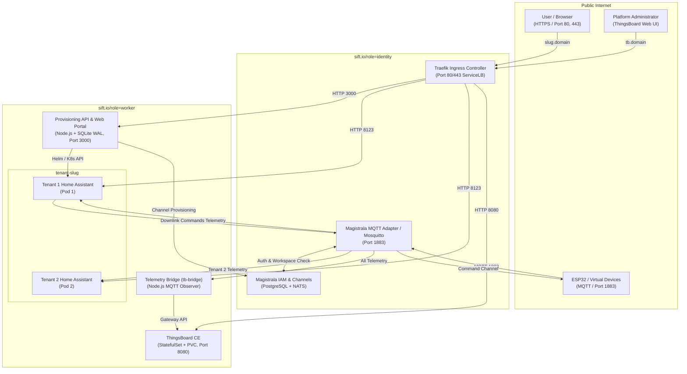
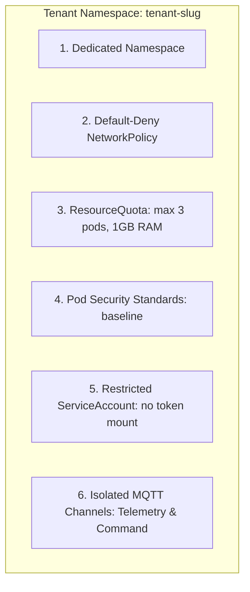
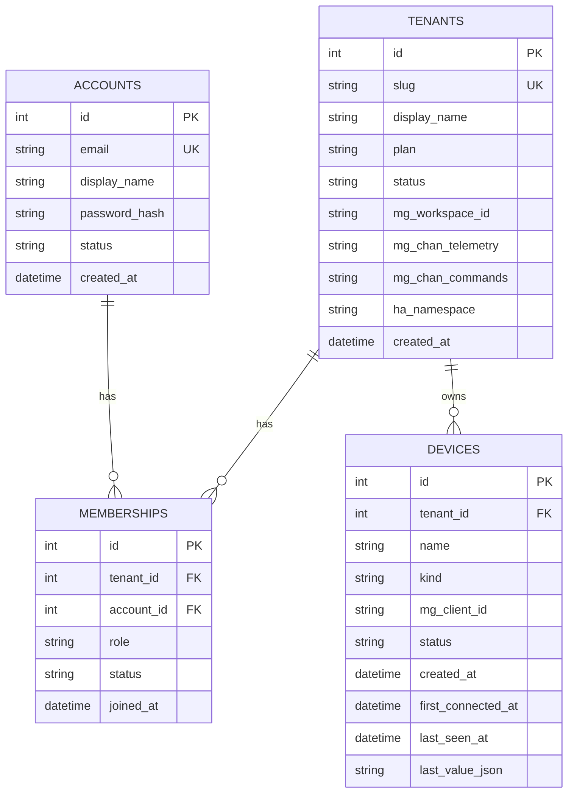

# THE-SIFT — Master Project Memory & Architecture Guide

**Project Name:** The-SIFT (Scalable IoT For Tenants)  
**Subtitle:** Multi-Tenant Cloud-Native IoT Smart-Home Automation Platform  
**Authors:** Shreyash Vaigankar (Seat No: 25P0320045) & Samuel D’Souza (Seat No: 25P0320041)  
**GitHub Repository:** [ShreyashV38/The-SIFT](https://github.com/ShreyashV38/The-SIFT)  
**Date:** October 2026  
**Document Purpose:** Single source of truth containing the complete architecture, implementation details, functional requirements, AWS cost models, viva answers, and deployment instructions.

---

## 1. Existing Documentation Files in the Repository

If you are looking for specific existing documents in the project:
1. **`docs/HOW_IT_WORKS.md`**: The living engineering log containing step-by-step Phase 0 to Phase 10B technical milestones, decision logs (D1–D16), endpoints, and verification checks.
2. **`The-SIFT_ Business Requirements Document.pdf`**: The official submitted BRD (v3.1) containing the formal academic specification, 15 Functional Requirements, constraints, and Section 7 Cost-Benefit Analysis.
3. **`docs/demo-script.md`**: The structured 6–8 minute viva/presentation demonstration script.
4. **`README.md`**: Quick-start guide and compliance mapping against the BRD.
5. **`PROJECT_MEMORY.md`** *(This file)*: The comprehensive, all-in-one master reference consolidating all of the above.

---

## 2. Executive Summary & Core Concept

Traditional smart-home systems (such as standalone Home Assistant) are designed strictly for a single household on a private local area network (LAN). They cannot serve multiple independent households securely from the cloud.

**The-SIFT solves this by providing:**
1. **Automated Cloud Onboarding:** When a user registers a household, the platform automatically provisions an isolated smart-home environment.
2. **Strong Multi-Tenant Isolation:** Zero-trust Kubernetes namespaces, `NetworkPolicy`, `ResourceQuota`, and isolated MQTT channels guarantee that no tenant can inspect, control, or intercept another household's data or smart devices.
3. **Unified IoT Ingestion:** Devices (physical ESP32 microcontrollers or software CLI simulators) authenticate against Magistrala MQTT using individual device secrets.
4. **Fleet Observability:** Administrators can monitor telemetry and device health across all households from a single central ThingsBoard CE dashboard without violating tenant privacy.

---

## 3. High-Level Architecture & Traffic Flow

The platform is designed to run on a **2-node Kubernetes (K3s) cluster on AWS EC2**:



### Two Distinct Traffic Paths:
1. **Human Web Traffic:** Browser → `https://<slug>.<domain>` → Traefik Ingress → Tenant's private Home Assistant Pod or Portal.
2. **Device IoT Traffic:** ESP32 / Simulator → `MQTT :1883` → Magistrala MQTT Broker → Delivered strictly to that tenant's channel subscribers (Tenant HA pod) and to `tb-bridge` (for ThingsBoard monitoring).

---

## 4. Microservices Breakdown

Understanding how services are partitioned:

### A. The 6 Platform Microservices (Runtime Pods in Kubernetes)
1. **Ingress & Reverse Proxy Gateway:** Traefik Ingress Controller (bundled in K3s).
2. **Core Provisioning & Web Portal:** `services/provisioning-api` (Unified API Gateway, accounts, members, devices, and UI).
3. **Telemetry Bridge Service:** `services/tb-bridge` (High-throughput standalone MQTT forwarder).
4. **IoT Message Broker Service:** Magistrala / Mosquitto MQTT Adapter (Port 1883).
5. **Device IAM & Channels Service:** Magistrala Core (PostgreSQL 16 + NATS).
6. **Fleet Observability Service:** ThingsBoard CE (Java + PostgreSQL on Port 8080).
7. **Per-Tenant Smart Home Instances:** Home Assistant instances spun up as isolated pods dynamically per household.

### B. Why `provisioning-api` is a Modular Monolith internally:
- Houses `accounts.js` (auth/login/2FA), `email.js`, `tenants.js`, `members.js`, and `devices.js`.
- **Reason 1 (RAM Budget):** Prevents running 5 duplicate Node.js V8 engines which would waste ~500 MB of RAM on our 2-node EC2 cluster.
- **Reason 2 (ACID Guarantees):** Allows tenant onboarding (account check → tenant creation → owner assignment) to execute within a single atomic SQLite transaction without distributed Sagas or network failures.

---

## 5. Compliance with BRD v3.1 (Functional Requirements FR-01 to FR-15)

Every feature in the platform adheres strictly to the official BRD:

| ID | Functional Requirement | Implementation Location | Verification Method |
|---|---|---|---|
| **FR-01** | Provisioning API accepts authenticated tenant onboarding | `services/provisioning-api/src/routes/tenants.js` | Create tenant via API / UI; verify Home Assistant access. |
| **FR-02** | Automatically creates Magistrala workspace, telemetry & command channels | `services/provisioning-api/src/services/magistrala.js` | Inspect created workspace and channels in Magistrala DB. |
| **FR-03** | Deploys isolated Home Assistant with full security stack | `deploy/ha-tenant/` (Helm chart, NetPol, Quota, PSS) | Automated Kubernetes namespace, NetPol, and quota checks. |
| **FR-04** | Device telemetry routes through MQTT to HA and ThingsBoard | `services/tb-bridge/src/index.js` | Publish MQTT message; verify live in HA and ThingsBoard. |
| **FR-05** | Device registration, single credential issuance, secret rotation, revocation | `services/provisioning-api/src/routes/devices.js` | Register device, view secret once, rotate, and revoke. |
| **FR-06** | Zero-trust cross-tenant isolation (network, data, devices) | `cluster/netpol-tenant-template.yaml` & RBAC | Cross-tenant network ping, API spoofing, and MQTT sniff tests. |
| **FR-07** | Admin fleet monitoring across all households | `deploy/thingsboard/`, `services/tb-bridge` | ThingsBoard CE multi-tenant dashboard and device list. |
| **FR-08** | Invalid or revoked device credentials rejected | Magistrala / Mosquitto password auth | Attempt MQTT connect with wrong secret; verify immediate drop. |
| **FR-09** | Pod self-healing on crash; node failure documented | Kubernetes Deployment controller (`replicas: 1`) | Kill HA pod; verify Kubernetes immediately spawns replacement. |
| **FR-10** | Load testing with recorded latency percentiles & metrics | `tools/simulator/simulator.js` (Scenarios S1–S5) | Run load tests with simulated devices; log throughput/latency. |
| **FR-11** | User accounts with salted bcrypt password hashing & JWT | `services/provisioning-api/src/routes/accounts.js` | Account registration, bcrypt (12 rounds), 2FA/OTP login. |
| **FR-12** | Plans (`single`: 1 seat / 10 dev, `family`: 6 seats / 30 dev) | `services/provisioning-api/src/routes/tenants.js` | Enforce limits; reject adding 2nd member on single plan. |
| **FR-13** | Member roles (`owner`, `admin`, `member`) & owner protection | `services/provisioning-api/src/middleware/rbac.js` | Test role hierarchy; verify owner cannot be deleted/demoted. |
| **FR-14** | Shared devices across all active household members | `services/provisioning-api/src/routes/devices.js` | Two members of same tenant both view and control devices. |
| **FR-15** | Isolated downlink command channel | Magistrala command channel (`channels/<id>/messages`) | Send relay command from HA; reaches only that tenant's device. |

---

## 6. Multi-Tenant Zero-Trust Isolation Architecture

Tenants are completely isolated across 6 layers:



1. **Network Isolation (`NetworkPolicy`):** Default-deny-all policy. Ingress to Home Assistant (port 8123) is permitted **ONLY** from Traefik in `kube-system`. Egress is restricted exclusively to DNS (port 53) and Magistrala MQTT (port 1883).
2. **Resource Sandboxing (`ResourceQuota`):** Each household is constrained to max 3 pods, 500m CPU request, 768Mi RAM request, and 1GiB RAM limit. No household can exhaust cluster memory (Noisy Neighbor protection).
3. **Identity Isolation (`ServiceAccount`):** `automountServiceAccountToken: false` ensures pods cannot query the Kubernetes API.
4. **Channel Isolation (Magistrala):** Each household receives two private MQTT channels (`telemetry` and `command`). Device secrets are cryptographically generated and tied strictly to their own channel.

---

## 7. Data Model & Database Schema

The database uses SQLite in WAL (Write-Ahead Logging) mode located at `/data/cloudnest.db`:



### Dynamic Device State Machine (Computed on read):
- **`pending`**: Provisioned via API, but `first_connected_at` is null (never seen on MQTT).
- **`online`**: Received telemetry within the last 90 seconds (`config.offlineAfterSeconds`).
- **`offline`**: Connected previously, but no telemetry received in the last 90 seconds.
- **`revoked`**: Manually revoked by administrator/owner; rejected by MQTT broker.

---

## 8. Frontend Portal & User Experience

Built strictly with **plain HTML, CSS, and Vanilla JavaScript** (Zero frameworks, no React/Next.js/TS, no build step):
- **Visual Identity:** *SIFT Signal Console* — light mode, midnight navy headers (`#0B192C`), electric teal accents (`#1C7293`), clean typography (Inter font).
- **Views (10 Complete Views):**
  1. `#/` — Live Dashboard (fleet overview, active households, live device metrics).
  2. `#/login` — User authentication with rate limiting and 2FA/OTP code verification.
  3. `#/register` — Account registration with instant auto-login.
  4. `#/create-household` — Household tenant wizard with Single vs Family plan selection.
  5. `#/t/:slug/devices` — Device inventory with online/offline indicators, workspace switcher next to Add Device button.
  6. `#/t/:slug/devices/new` — **4-Step Add Device Wizard**:
     - *Step 1:* Prominent platform selection (**Physical ESP32 Microcontroller** vs **Virtual Device Simulator**) + Capability selection (**Telemetry Sensor** vs **Switch / Actuator**).
     - *Step 2:* Tailored credentials: WiFi SSID/password embedder for ESP32; ready-to-run 1-click terminal command (`npm install mqtt && node one-device.js --config .\sift-device.json`) for Virtual Simulator.
     - *Step 3:* Platform-matched connection guide with live 3-second MQTT telemetry polling.
     - *Step 4:* Verified online confirmation with direct links to Home Assistant.
  7. `#/t/:slug/devices/:id` — Device detail view, real-time telemetry card, relay command buttons (`ON`/`OFF`), secret rotation, and revocation.
  8. `#/t/:slug/members` — Member directory, role upgrades (`member` ↔ `admin`), ownership transfer, seat limit indicators, email invite dispatcher.
  9. `#/t/:slug/plan` — Subscription tier management with downgrade limit validation.
  10. `#/help` — Hardware wiring pinouts (DHT22 on GPIO 15, Relay on GPIO 2), Arduino libraries guide, MQTT connection troubleshooting.

---

## 9. Cost-Benefit Analysis (Section 7 of BRD)

Comparing AWS deployment models (us-east-1 on-demand pricing, 730 hours/month):

| Component | Managed AWS Baseline (Expensive) | The-SIFT Optimized (Your Design) | Savings Strategy |
|---|---|---|---|
| **Kubernetes Control Plane** | $73.00 / mo *(AWS EKS)* | **$0.00** | Self-managed K3s runs directly on Node 1 |
| **Compute Nodes** | $121.47 / mo *(2 × `t3.large`)* | **$121.48 / mo** *(2 × `t3.large`)* | Node 1: Identity & MQTT; Node 2: Worker & Apps |
| **Databases** | $29.42 / mo *(2 × AWS RDS)* | **$16.00 / mo** | In-cluster Postgres + SQLite WAL on 200 GB gp3 |
| **Load Balancer & Network** | $55.27 / mo *(ALB + NAT Gateway)*| **$26.97 / mo** | Traefik Ingress + K3s ServiceLB |
| **Public IPv4 Addresses** | $10.95 / mo *(3 IPs)* | **$7.30 / mo** *(2 IPs)* | 1 public IP per EC2 node |
| **Root Volumes** | $3.20 / mo *(2 × 20 GB gp3)* | **$3.20 / mo** *(2 × 20 GB gp3)* | Base root storage |
| **Total Monthly Cost** | **~$293.31 / month** | **~$174.95 / month** | **40% Cost Reduction (Saves $118.36/mo)** |

### How the $180 AWS Credit Applies:
- Running 24/7 at the full production scale ($174.95/mo) is **100% covered for 1 entire month** by your $180 credit.
- Running on-demand during active testing/evaluation costs only **~$0.24 / hour**. Stopping instances when not in use means the $180 credit will last for **many months**.

---

## 10. Viva / Architecture Defense Q&A Cheat Sheet

### Q1: Is there auto-scaling in this project?
> **Answer:** *"There is no metric-based Horizontal Pod Autoscaling (HPA) scaling individual Home Assistant pods based on CPU/RAM, because Home Assistant is stateful per household (running multiple replicas would cause SQLite database locks). However, the platform features **Event-Driven Tenant Auto-Provisioning**: whenever a new household registers, the Provisioning API dynamically creates a new namespace and spawns an isolated Home Assistant pod. In addition, Kubernetes provides **Self-Healing**: if any pod crashes, Kubernetes automatically detects the failure and brings up a fresh replacement pod."*

### Q2: Why didn't you use a Managed Instance Group (MIG) like taught in the lab?
> **Answer:** *"Managed Instance Groups (MIG) or Auto Scaling Groups are designed for stateless, identical clone servers (like Nginx web servers) behind a load balancer. The-SIFT has heterogeneous workloads with specific node roles: Node 1 handles the MQTT message broker and IAM, while Node 2 handles ThingsBoard, tenant Home Assistant pods, and APIs. Furthermore, stateful databases (Postgres/SQLite) cannot survive random VM terminations. We use **Kubernetes (K3s)** instead of MIG because Kubernetes manages container scheduling, namespace isolation (`NetworkPolicy`), and pod self-healing natively without the overhead and data loss of recreating virtual machines."*

### Q3: Why is the Provisioning API a Modular Monolith instead of separate microservices?
> **Answer:** *"We followed Domain-Driven Design with clear bounded contexts (Auth, Tenants, Members, Devices). We bundled them into a Modular Monolith for the API tier to optimize memory footprint—avoiding 5 separate Node.js runtimes that would waste 500 MB of RAM on our EC2 instances—and to guarantee atomic ACID transactions during tenant onboarding without distributed transaction latency. Meanwhile, the data plane components—Magistrala MQTT, Telemetry Bridge (`tb-bridge`), ThingsBoard, and Home Assistant—are deployed as fully independent microservices."*

### Q4: How do you prevent cross-tenant data leaks?
> **Answer:** *"Isolation is enforced across all layers: Kubernetes `NetworkPolicy` drops any inter-namespace pod communication. `ResourceQuota` prevents CPU/RAM starvation. Magistrala generates separate cryptographic client secrets and dedicated MQTT channels (`telemetry` and `commands`) for each tenant, so one household can never eavesdrop on or send commands to another household's smart devices."*

---

## 11. Quick Reference: Local Commands & Verification

### Running the Platform Locally:
```powershell
# 1. Start local bootstrap (checks tools, applies manifests, starts API):
.\start-local.ps1

# 2. Stop local environment and cleanup background processes:
.\stop-local.ps1
```

### Running Automated Test Suite:
```powershell
node tools/tests/test_suite.js
```

### Running Load Simulator (Scenarios S1 to S5):
```powershell
# Scenario S1: Steady-state telemetry test (3 tenants, 10 devices, 30s)
node tools/simulator/simulator.js --scenario=s1 --tenants=3 --devices=10 --duration=30

# Scenario S4: Invalid credentials rejection test (FR-08)
node tools/simulator/simulator.js --scenario=s4 --duration=10

# Scenario S5: Downlink command round-trip test (FR-15)
node tools/simulator/simulator.js --scenario=s5 --duration=10
```

### Running Virtual Device CLI:
```powershell
npm install mqtt
node tools/simulator/one-device.js --config .\sift-device.json
```
