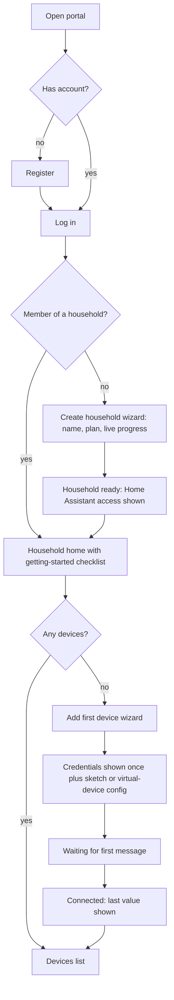
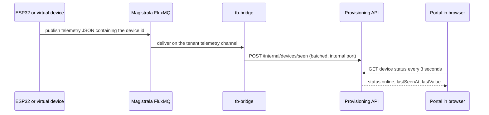

# SIFT PORTAL PROMPT — Phase 6C: Tenant Portal and First-Time ESP32 Onboarding

Paste this whole file into the coding agent that already holds `SIFT_BUILD_PROMPT.md` and `docs/HOW_IT_WORKS.md`.

---

## 0. HOW TO USE THIS PROMPT

- Prerequisite: Phases 0–6B are done, or at least these exist and work: Provisioning API (auth, tenants, members, devices, plans), tb-bridge, simulator, Home Assistant tenant chart. If anything is missing, report it in Step 6C.0 and ask. Do not silently build around gaps.
- Precedence when documents disagree: the BRD (graded) first, then this file, then `SIFT_BUILD_PROMPT.md`. Use the BRD's words ("workspace", "device") and the exact names of the pinned Magistrala release.
- Where this prompt says UNVERIFIED, you must test it against the pinned versions and record the result in `docs/HOW_IT_WORKS.md`.

## 1. WORKING RULES

Rules R1–R12 of `SIFT_BUILD_PROMPT.md` still apply (explain before acting, one step at a time, stop gates waiting for `GO`, PowerShell commands in separate copy-paste blocks, pinned versions, git commit per step, docs updated every step, honesty). Extra rules for this phase:

P1. EXPLAIN BEFORE ACT. Before each step print: Goal / Why / What I will change / How I will verify / Risk.
P2. VERIFY TWICE. Every step is verified in the browser and by calling the API directly. Show the evidence.
P3. NO FRAMEWORKS, NO CDN, NO BUILD STEP in the browser. Plain HTML, CSS and JavaScript (ES modules), served by the Provisioning API. Reason: works offline, nothing to audit, easy to explain in a viva.
P4. SECRETS. Device secrets, the Home Assistant password and session tokens must never appear in localStorage, sessionStorage, IndexedDB, URLs, console output, server logs or HTML comments. They live in a JavaScript variable only while the wizard that shows them is open.
P5. THE SERVER IS THE AUTHORITY. Hiding a button is cosmetic. Every rule (role, plan limit, tenant isolation) is enforced by the API and tested by calling the API directly.
P6. DO NOT INVENT. Magistrala field names, topic formats, MQTT behaviour, Home Assistant UI paths and library versions come from the official docs of the pinned versions.
P7. THE BRD IS GRADED. Build only the "Must" items in section 2 unless the user approves more. At the end report exactly what was built so the BRD can be matched (section 14).
P8. TIME-BOX. If behind schedule, follow the cut list (section 15). Never leave a half-built feature visible in the UI: finish it, hide it, or remove it.

## 2. GOAL AND SCOPE

Goal: a person who has never seen the system can register, create a household, connect their first ESP32 (or a virtual device if they have no hardware), and see it shown as "Connected" with its latest value, guided by the portal at every step. Target: under 15 minutes. Measure the real time in the demo run and record it.

Users: Owner (creates the household, first-time user) and Member (uses the household's devices).

### MUST (committed, goes into the BRD)

- M1 Portal served by the Provisioning API on the same origin as the API.
- M2 Register, log in, log out, session bootstrap.
- M3 Create-household wizard with live provisioning progress.
- M4 Household home page with a getting-started checklist and a Home Assistant access panel.
- M5 Devices list showing status (pending, online, offline, revoked), last seen, last value.
- M6 Add-device wizard: credentials shown once, downloadable ESP32 sketch, downloadable virtual-device config, automatic detection of the first connection.
- M7 Device actions: rotate secret, revoke.
- M8 Help page: ESP32 connection guide, virtual-device guide, troubleshooting table. Works without login and offline.
- M9 Members page (add existing account by email, change role, remove) and plan and usage panel (owner changes plan). Role-aware.
- M10 Server-enforced roles and tenant isolation on every portal call; security headers; CSRF defence.

### SHOULD (only if every Must is done and tested; do not add to the BRD unless built)

- S1 "Send test command" button on a switch device.
- S2 Delete household (owner, type the slug to confirm).
- S3 Captive-portal firmware (Appendix A).
- S4 Browser-based flashing (Appendix B).

### NOT DOING (never build; list them as out of scope in the BRD)

Per-tenant ThingsBoard accounts (ThingsBoard stays platform-admin only), email sending, invitation links, email verification, billing, mobile app, social login, single sign-on into Home Assistant, per-member Home Assistant logins, MQTT over TLS in the local environment, translations, dark mode, front-end frameworks, analytics, audit-log screen.

## 3. USER JOURNEY



How "connected" is detected:



First-time rules (all derived from server data, never from localStorage):

- Logged in and `me.tenants` is empty -> go to the create-household wizard.
- Household ready and it has 0 devices -> show the "Add your first device" call to action on the household home.
- A user in several households gets a household switcher in the header.

## 4. ARCHITECTURE CHANGES (small)

1. Static files live in `services/provisioning-api/public/` (`index.html`, `styles.css`, `js/*.js`). Hash routing (`#/...`), so no server rewrite rules are needed.
2. Ingress host `app.<domain>` (local: `app.localtest.me`) routes everything to the Provisioning API main port (8080): portal files and `/v1/*`. Keep an `api.<domain>` alias only if scripts already use it. No CORS headers: the portal is same-origin.
3. Reserved slugs: add `app`, `portal`, `www` to the existing reserved list.
4. The internal endpoint (`/internal/*`) listens on a SECOND port (8081) exposed by a separate ClusterIP Service that no Ingress references. A NetworkPolicy allows port 8081 only from the tb-bridge pods. It also requires the header `X-Internal-Token` (value from a Kubernetes Secret, compared in constant time).
5. SQLite additions on `devices`: `first_connected_at`, `last_seen_at`, `last_value_json` (max 2 KB). Add a migration.
6. tb-bridge additionally reports device activity to the internal endpoint (section 6.3).

## 5. API CONTRACT USED BY THE PORTAL

Conventions: JSON only. State-changing requests (POST, PATCH, PUT, DELETE) must send `Content-Type: application/json` and the header `X-SIFT-CSRF: 1`; otherwise return 403 `CSRF`. Session = httpOnly cookie `sift_session`, `SameSite=Strict`, `Secure` only when `COOKIE_SECURE=true` (plain-HTTP local environment: false, because browsers reject Secure cookies on `*.localtest.me` over HTTP; AWS with TLS: true). Errors always use:

```json
{ "error": { "code": "PLAN_LIMIT", "message": "Human readable text", "details": {} } }
```

Error codes: `VALIDATION` 400, `UNAUTHENTICATED` 401, `FORBIDDEN` 403, `CSRF` 403, `NOT_FOUND` 404, `ACCOUNT_NOT_FOUND` 404, `SLUG_TAKEN` 409, `ALREADY_MEMBER` 409, `PLAN_LIMIT` 409, `LAST_OWNER` 409, `RATE_LIMITED` 429. Use 404 (not 403) when a user asks for a tenant they do not belong to, so tenant names are not revealed.

### 5.1 Endpoints

Endpoints marked NEW must be added in Step 6C.1. Others should already exist from Phase 6B; if a name or shape differs, adapt the portal to the existing API and record it.

| Method and path | Who | Purpose |
|---|---|---|
| GET /v1/config (NEW, no auth) | anyone | MQTT host, port, tls flag; tenant domain; plan limits; `offlineAfterSeconds`; `warnings` list |
| POST /v1/auth/register | anyone | email, displayName, password (min 10, max 128) -> 201; portal then calls login |
| POST /v1/auth/login | anyone | sets session cookie; rate limited |
| POST /v1/auth/logout | session | clears cookie |
| GET /v1/me | session | account plus `tenants: [{slug, displayName, role, plan, status}]` |
| POST /v1/tenants | session | slug, displayName, plan -> 202 (or 201 if provisioning is synchronous); caller becomes owner |
| GET /v1/tenants/:slug | member | status (`provisioning`, `ready`, `failed`), `steps` with name/status/ms, urls, limits and usage (`seats {used,max}`, `devices {used,max}`), caller role |
| GET /v1/tenants/:slug/ha-access (NEW) | active member | Home Assistant URL, shared username and password; response header `Cache-Control: no-store` |
| PATCH /v1/tenants/:slug/plan | owner | change plan; 409 `PLAN_LIMIT` with details if usage exceeds the new limits |
| DELETE /v1/tenants/:slug | owner | delete household (also used for "failed" cleanup) |
| GET /v1/tenants/:slug/members | admin or owner | list |
| POST /v1/tenants/:slug/members | admin or owner | `{email, role}` adds an EXISTING account directly (BRD: no invitation links) |
| PATCH /v1/tenants/:slug/members/:accountId | admin or owner | change role (owner transfer rules from Phase 6B apply) |
| DELETE /v1/tenants/:slug/members/:accountId | admin or owner | remove; last owner protected |
| GET /v1/tenants/:slug/devices | member | list with computed status, `lastSeenAt`, `lastValue` |
| POST /v1/tenants/:slug/devices | admin or owner | `{name, kind}` with kind `sensor` or `switch` -> 201, credentials returned once (5.2) |
| GET /v1/tenants/:slug/devices/:id/status (NEW) | member | same item shape as a list entry, for polling |
| POST /v1/tenants/:slug/devices/:id/rotate-secret | admin or owner | new credentials returned once |
| DELETE /v1/tenants/:slug/devices/:id | admin or owner | revoke (Magistrala credentials disabled) |
| POST /v1/tenants/:slug/devices/:id/test-command (SHOULD S1) | member | `{state: "ON" or "OFF"}` for switch devices |
| POST /internal/devices/seen (NEW, port 8081) | tb-bridge only | activity reports (6.3) |

### 5.2 Device creation response

Field names are generic on purpose: the API maps the pinned Magistrala release onto them (UNVERIFIED: which of `clientId`, `username`, `password` the broker really needs; read the docs and fill them correctly).

```json
{
  "device": { "id": "dev_...", "name": "Living room", "kind": "sensor", "status": "pending" },
  "credentials": {
    "mqttHost": "192.168.1.20", "mqttPort": 1883, "tls": false,
    "clientId": "...", "username": "...", "password": "...",
    "telemetryTopic": "...", "commandTopic": "..."
  },
  "shownOnce": true
}
```

### 5.3 Device list item and status

```json
{ "id": "dev_...", "name": "Living room", "kind": "sensor",
  "status": "online", "firstConnectedAt": "2026-10-24T10:00:00Z",
  "lastSeenAt": "2026-10-24T10:05:10Z", "lastValue": { "temperature": 24.6 } }
```

Status is computed at read time, never stored: `revoked` if revoked; else `pending` if `firstConnectedAt` is null; else `online` if now minus `lastSeenAt` is at most `offlineAfterSeconds` (default 90, configurable); else `offline`. Never return a secret from list or status endpoints.

### 5.4 Config response and warnings

`GET /v1/config` returns `{ mqtt: {host, port, tls}, tenantDomain, offlineAfterSeconds, plans, warnings: [] }`. `mqtt.host` comes from the environment variable `PUBLIC_MQTT_HOST`. Add a warning string when the host is `localhost`, `127.0.0.1`, `host.docker.internal` or empty: an ESP32 cannot reach those names. The portal shows warnings in a banner on the add-device wizard. For local demos set `PUBLIC_MQTT_HOST` to the computer's LAN IP, and allow inbound TCP 1883 in Windows Firewall for the private network.

## 6. SERVER-SIDE WORK DETAILS

6.1 Security headers on every response: `Content-Security-Policy: default-src 'none'; script-src 'self'; style-src 'self'; img-src 'self' data:; connect-src 'self'; font-src 'self'; base-uri 'none'; form-action 'self'; frame-ancestors 'none'`, `X-Content-Type-Options: nosniff`, `Referrer-Policy: no-referrer`. Check the browser console; if file downloads need an extra directive, add the minimum and record why (UNVERIFIED). `Cache-Control: no-store` on every response that contains credentials.

6.2 Rate limits: login 5 attempts per minute per IP plus email; general API 120 requests per minute per session (so wizard polling every 3 seconds never trips it).

6.3 tb-bridge reporting: the bridge already subscribes to every tenant's telemetry channel. For each message it extracts the device `id` from the JSON payload and the channel's tenant slug, then every 2 seconds sends one batch:

```json
{ "reports": [ { "tenantSlug": "acme", "deviceId": "dev_...", "ts": "2026-10-24T10:05:10Z", "values": { "temperature": 24.6 } } ] }
```

The API ignores any report whose device does not belong to that tenant (counter `reports_rejected`), sets `first_connected_at` if null, updates `last_seen_at` and `last_value_json` (truncate to 2 KB), and caps body size at 256 KB. Messages without an `id` are counted by the bridge as `unknown_device` and not reported. UNVERIFIED: whether Magistrala forwards the raw JSON payload to subscribers unchanged (read the docs of the pinned release); if the publisher identity is available some other way, use it and record the change in the payload contract.

## 7. PORTAL PAGES

Routes (hash based). Every page needs a loading state, an empty state, and an error state with a retry button.

| Route | Access | Content |
|---|---|---|
| #/login, #/register | public | forms; register shows "student project: do not reuse a real password" and no email verification |
| #/ | session | router: no household -> create wizard; else household home |
| #/create-household | session | step 1 name and slug (client validation mirrors server: `^[a-z][a-z0-9-]{2,30}$`, reserved words rejected by server); step 2 plan cards showing seats and devices from `/v1/config`; step 3 live progress list (poll status every 3 s; show step names and elapsed time); step 4 ready screen with Home Assistant URL and credentials. On `failed`: show the failed step and a "Delete and try again" button (owner) |
| #/t/:slug | member | getting-started checklist, Home Assistant access panel, usage meters, shortcuts |
| #/t/:slug/devices | member | table of devices with status badge, last seen (relative time), last value; "Add device" button hidden for plain members |
| #/t/:slug/devices/new | admin or owner | add-device wizard (section 8) |
| #/t/:slug/devices/:id | member | detail: status, topics, no secret; rotate secret and revoke for admin or owner; "setup instructions" link |
| #/t/:slug/members | admin or owner | members table, add by email with role, change role, remove |
| #/t/:slug/plan | owner | current plan, usage, change plan with clear limit messages |
| #/help/esp32 | public | section 10 |

Getting-started checklist (computed from server data):

1. Household created: `status == ready`.
2. First device added: devices count at least 1.
3. First device connected: any device has `firstConnectedAt`.
4. Recommended on a family plan: add a household member (members count at least 2).

Plus two action cards that are not checkboxes: "Open Home Assistant" and "Read the ESP32 guide".

Home Assistant access panel: URL, username, password (hidden by default, show and copy buttons), plus the sentence "Everyone in your household uses this one login." Fetched from `/ha-access` only when the panel is opened.

UI quality rules: semantic HTML, every input has a label, buttons are `<button>`, status changes announced in an `aria-live` region, keyboard-only completion possible, usable at 360 px width, text contrast readable, no colour-only meaning (badges also carry text). All user-supplied text is inserted with `textContent`, never `innerHTML`.

## 8. ADD-DEVICE WIZARD (the first-time ESP32 guide)

Show a stepper "1 Name, 2 Credentials, 3 Connect, 4 Done". The first time (zero devices) a short intro explains: "A device is any ESP32 board, or a virtual device on your computer."

Step 1 — Name and type. Name (1–40 chars, letters, digits, spaces, hyphen), kind: Sensor (reports a value) or Switch (can be turned ON and OFF). If the plan's device limit is reached, show the `PLAN_LIMIT` message instead of the form. Show the `/v1/config` warnings banner here.

Step 2 — Credentials (shown once). Show host, port, client id, username, password, telemetry topic, command topic, each with a copy button. Red notice: "These secrets are shown only once. Not encrypted in this demo (plain MQTT)." The "Continue" button stays disabled until the user ticks "I have saved these credentials". Offer two generated downloads, both created in the browser with `Blob` and never sent to the server, plus one static file:
 - `sift-device.ino` (ESP32 sketch, section 9.1). Optional fields "WiFi name" and "WiFi password" fill the sketch; if left empty the sketch keeps the placeholders `YOUR_WIFI_NAME` and `YOUR_WIFI_PASSWORD`. Say: "Your WiFi details never leave this page."
 - `sift-device.json` (virtual-device config, section 9.2).
 - `one-device.js` (static file served by the portal at `/tools/one-device.js`; only needed for the virtual device, section 9.3).

Step 3 — Connect. Two tabs:
 - "I have an ESP32": numbered instructions identical to the help page (install Arduino IDE 2, add ESP32 board package, select ESP32 Dev Module, install PubSubClient, open the sketch, enter WiFi, upload, open Serial Monitor at 115200 baud), and the exact Serial lines to expect.
 - "No hardware": install Node.js LTS, then run the virtual-device command from section 9.3.
 Below the tabs, a live status box polls the device status every 3 seconds: "Waiting for the first message..." with a spinner. After 5 minutes without a connection show: "Still waiting. Check the troubleshooting guide" with a link. Stop polling when the page is left.

Step 4 — Done. Shows "Connected", last seen, last value. For a switch, show that commands are sent from Home Assistant (and the test button if S1 was built). Show a "Open Home Assistant" button and the hint: "In Home Assistant, search for your device name under Settings, Devices and services, Entities" (UNVERIFIED: menu names for the pinned Home Assistant version; verify and correct). Then "Back to devices".

If the user leaves before saving credentials: warn with a confirm dialog; the only recovery is "Rotate secret" on the device page. Say this plainly in the dialog.

## 9. GENERATED ARTIFACTS

### 9.1 ESP32 sketch template (reference; you must compile it)

Libraries: only `PubSubClient` by Nick O'Leary (version 2.8 or newer; `setBufferSize` needs 2.8). Board: "ESP32 Dev Module". Values inserted into string literals must be escaped for C (backslash, double quote, newline). The downloaded file name is always `sift-device.ino` so the Arduino IDE folder name matches (the IDE offers to create a folder named `sift-device`).

Payload contract: telemetry is one JSON object per message with a string `id` (the device id, required) plus measurement fields, for example `{"id":"dev_x","temperature":24.6}`; a switch reports `{"id":"dev_x","state":"ON"}`. Commands are the plain text `ON` or `OFF`.

```cpp
// SIFT device sketch for: {{DEVICE_NAME}} ({{DEVICE_KIND}})
#include <WiFi.h>
#include <PubSubClient.h>

// ---- 1. Your WiFi (2.4 GHz only) ----
const char* WIFI_SSID     = "{{WIFI_SSID}}";
const char* WIFI_PASSWORD = "{{WIFI_PASSWORD}}";

// ---- 2. SIFT connection (generated, keep private) ----
const char*    MQTT_HOST       = "{{MQTT_HOST}}";
const uint16_t MQTT_PORT       = {{MQTT_PORT}};
const char*    MQTT_CLIENT_ID  = "{{MQTT_CLIENT_ID}}";
const char*    MQTT_USERNAME   = "{{MQTT_USERNAME}}";
const char*    MQTT_PASSWORD   = "{{MQTT_PASSWORD}}";
const char*    TOPIC_TELEMETRY = "{{TOPIC_TELEMETRY}}";
const char*    TOPIC_COMMAND   = "{{TOPIC_COMMAND}}";
const char*    DEVICE_ID       = "{{DEVICE_ID}}";
const char*    DEVICE_KIND     = "{{DEVICE_KIND}}";   // "sensor" or "switch"
const unsigned long PUBLISH_EVERY_MS = {{PUBLISH_INTERVAL_MS}};

#ifndef LED_BUILTIN
#define LED_BUILTIN 2
#endif

WiFiClient net;
PubSubClient mqtt(net);
bool switchOn = false;
float temperature = 24.0;
unsigned long lastPublish = 0;

void publishState();

void connectWifi() {
  Serial.printf("WiFi connecting to %s\n", WIFI_SSID);
  WiFi.mode(WIFI_STA);
  WiFi.begin(WIFI_SSID, WIFI_PASSWORD);
  unsigned long start = millis();
  while (WiFi.status() != WL_CONNECTED) {
    delay(500);
    Serial.print(".");
    if (millis() - start > 20000) {
      Serial.println("\nWiFi failed, restarting");
      ESP.restart();
    }
  }
  Serial.printf("\nWiFi connected: %s\n", WiFi.localIP().toString().c_str());
}

void onMessage(char* topic, byte* payload, unsigned int length) {
  char msg[32];
  unsigned int n = length < sizeof(msg) - 1 ? length : sizeof(msg) - 1;
  memcpy(msg, payload, n);
  msg[n] = 0;
  Serial.printf("Command received: %s\n", msg);
  if (strcmp(DEVICE_KIND, "switch") != 0) return;
  if (strcmp(msg, "ON") == 0) switchOn = true;
  else if (strcmp(msg, "OFF") == 0) switchOn = false;
  else return;
  digitalWrite(LED_BUILTIN, switchOn ? HIGH : LOW);
  publishState();
}

void publishState() {
  char body[160];
  if (strcmp(DEVICE_KIND, "switch") == 0) {
    snprintf(body, sizeof(body), "{\"id\":\"%s\",\"state\":\"%s\"}", DEVICE_ID, switchOn ? "ON" : "OFF");
  } else {
    temperature += ((int)random(-5, 6)) / 10.0f;   // simulated reading: replace with your sensor
    if (temperature < 15) temperature = 15;
    if (temperature > 35) temperature = 35;
    snprintf(body, sizeof(body), "{\"id\":\"%s\",\"temperature\":%.1f}", DEVICE_ID, temperature);
  }
  bool ok = mqtt.publish(TOPIC_TELEMETRY, body);
  Serial.printf("Published (%s): %s\n", ok ? "ok" : "FAILED", body);
}

void connectMqtt() {
  int delayMs = 1000;
  while (!mqtt.connected()) {
    Serial.println("MQTT connecting...");
    if (mqtt.connect(MQTT_CLIENT_ID, MQTT_USERNAME, MQTT_PASSWORD)) {
      Serial.println("MQTT connected");
      mqtt.subscribe(TOPIC_COMMAND);
      publishState();
      return;
    }
    Serial.printf("MQTT failed, rc=%d, retry in %d ms\n", mqtt.state(), delayMs);
    delay(delayMs);
    if (delayMs < 30000) delayMs *= 2;
    if (WiFi.status() != WL_CONNECTED) connectWifi();
  }
}

void setup() {
  Serial.begin(115200);
  pinMode(LED_BUILTIN, OUTPUT);
  connectWifi();
  mqtt.setServer(MQTT_HOST, MQTT_PORT);
  mqtt.setBufferSize(512);
  mqtt.setKeepAlive(30);
  mqtt.setCallback(onMessage);
}

void loop() {
  if (WiFi.status() != WL_CONNECTED) connectWifi();
  if (!mqtt.connected()) connectMqtt();
  mqtt.loop();
  if (millis() - lastPublish >= PUBLISH_EVERY_MS) {
    lastPublish = millis();
    publishState();
  }
}
```

Known risk (UNVERIFIED): PubSubClient speaks MQTT 3.1.1. Confirm that FluxMQ in the pinned Magistrala accepts 3.1.1 clients and the chosen authentication fields. If not, switch the sketch to another client library and update the help page. The default PubSubClient buffer is 256 bytes, which is why the sketch calls `setBufferSize(512)`; a missing call makes publishes fail silently.

### 9.2 `sift-device.json`

```json
{
  "schema": 1,
  "tenant": "acme",
  "device": { "id": "dev_...", "name": "Living room", "kind": "sensor" },
  "mqtt": {
    "host": "192.168.1.20", "port": 1883, "tls": false,
    "clientId": "...", "username": "...", "password": "...",
    "telemetryTopic": "...", "commandTopic": "..."
  },
  "publishIntervalSeconds": 10
}
```

The file contains the secret. The portal says so next to the download button.

### 9.3 Virtual device CLI (`tools/simulator/one-device.js`)

Node.js script using the `mqtt` npm package, kept in `tools/simulator/one-device.js` and also served by the portal as the static file `/tools/one-device.js` (so the user does not need to clone the repo). It reads the config, connects (`clientId`, `username`, `password`, reconnect every 2 seconds), publishes the same payloads as the sketch every `publishIntervalSeconds`, subscribes to the command topic and obeys `ON` and `OFF`, and prints the same human-readable lines as the sketch. Commands shown in the wizard and on the help page, run in a folder that contains the two downloaded files:

```powershell
npm install mqtt
node one-device.js --config .\sift-device.json
```

## 10. HELP PAGE `#/help/esp32` (public, works offline)

Sections: What you need (ESP32 board, data-capable USB cable, a 2.4 GHz WiFi network because ESP32 boards do not support 5 GHz, a computer, the connection details from the wizard); Step by step (Arduino IDE 2, board manager URL `https://espressif.github.io/arduino-esp32/package_esp32_index.json`, board "ESP32 Dev Module", install PubSubClient, open `sift-device.ino` and accept the folder prompt, set WiFi, choose the port, Upload, Serial Monitor 115200); What you should see (Serial lines: `WiFi connected: <ip>`, `MQTT connecting...`, `MQTT connected`, `Published (ok): ...`); Virtual device; Where is my data (device page, then Home Assistant); Local-network note (the board must reach the MQTT host and port from its WiFi; `*.localtest.me` names only work on the computer running the system); Security note (demo MQTT is not encrypted).

Troubleshooting table (symptom, likely cause, fix):

| Symptom | Likely cause | Fix |
|---|---|---|
| Port not listed in Arduino IDE | Charge-only cable or missing USB-serial driver | Use a data cable; install the CP210x or CH340 driver that matches the board; try another USB port |
| Upload stuck on "Connecting......" or "Wrong boot mode" | Board not in flash mode | Hold the BOOT button while uploading, release when writing starts |
| Serial shows dots then restarts | Wrong WiFi name or password, or 5 GHz network | Check spelling and case; use a 2.4 GHz network or phone hotspot |
| `MQTT failed, rc=-2` | Board cannot reach the MQTT host | Host must be the computer's LAN IP or the public AWS address, not localhost; allow TCP 1883 in the firewall or security group |
| `rc=-4` | Connection timeout | Same checks as rc=-2; check the board and server are on reachable networks |
| `rc=2` | Client id rejected | Re-flash with the credentials from the wizard; rotate the secret if unsure |
| `rc=4` | Bad username or password | Re-flash the exact values shown; rotate the secret and re-flash |
| `rc=5` | Not authorised (device revoked or not allowed) | Check the device on the devices page; create or rotate |
| `Published (FAILED)` | Payload larger than the client buffer, or connection dropped | Keep `setBufferSize(512)`; check MQTT connected line |
| Serial says Published (ok) but the portal says Waiting | Wrong topic, or payload without the `id` field | Compare the topic with the device page; keep the payload format of the sketch |
| Portal shows Offline | Board lost WiFi or power, or interval longer than the offline threshold | Check Serial output; default threshold 90 s with a 10 s interval |
| Data in portal but not in Home Assistant | Entity not created yet | Search the device name in Home Assistant (UNVERIFIED path); ask the platform admin to check the MQTT integration |
| Lost the secret | Shown only once | Device page, Rotate secret, then re-flash |

Verify every row against real behaviour where possible and remove rows you could not confirm.

## 11. SECURITY REQUIREMENTS

- Cookies: httpOnly, SameSite=Strict, Secure when `COOKIE_SECURE=true`, short lifetime (suggest 8 hours), cleared on logout.
- CSRF: SameSite cookie plus mandatory custom header `X-SIFT-CSRF: 1` and JSON content type on state-changing requests; no CORS.
- XSS: no inline scripts or styles, strict CSP (6.1), all user text rendered with `textContent`.
- Passwords: min 10 characters, hashed with argon2id or bcrypt (as built in 6B); generic login error text; login rate limit.
- Enumeration: `ACCOUNT_NOT_FOUND` on "add member" reveals whether an email has an account. Accept this because only admins and owners can call it, it is rate limited, and the BRD requires adding existing accounts directly. Record the trade-off in the docs.
- Secrets: P4. Responses containing secrets send `Cache-Control: no-store`. Server logs redact password fields, Authorization, cookies, `credentials` objects and `X-Internal-Token`.
- Isolation: every `/v1/tenants/:slug/*` call checks membership and role from the database on each request.
- Internal endpoint: separate port, NetworkPolicy to tb-bridge only, token header, body-size limit, validation, tenant/device ownership check.
- The wizard never sends WiFi details to the server.

## 12. BUILD STEPS (each ends with a stop gate)

6C.0 Preconditions. Check the Phase 6B API, tb-bridge, simulator, tenant chart and `mqtt.yaml` entity generation. List gaps, propose the order, wait for `GO`.
6C.1 Server groundwork: `/v1/config`, `PUBLIC_MQTT_HOST` and warnings, tenant status with steps, `/ha-access`, device status fields and migration, second internal port with Service and NetworkPolicy, `/internal/devices/seen`, tb-bridge reporter, error format, CSRF middleware, security headers, static hosting, Ingress host `app.<domain>`, reserved slugs. Test every endpoint with `curl.exe` (use JSON files, not inline JSON).
6C.2 Portal skeleton: `index.html`, `styles.css`, `js/api.js` (fetch wrapper adding the CSRF header and mapping error codes), `js/router.js`, `js/views/*.js`, `js/ui.js` (toasts, aria-live, copy helper). Login and register views, session bootstrap, logout.
6C.3 Create-household wizard and progress polling, including the failed state.
6C.4 Household home: checklist, usage meters, Home Assistant access panel, household switcher.
6C.5 Devices list and device detail, rotate and revoke.
6C.6 Add-device wizard, status polling, two downloads.
6C.7 Generators: compile the sketch (below), run the virtual-device CLI, serve `/tools/one-device.js`.
6C.8 Help page and troubleshooting table.
6C.9 Members page and plan page (role-aware).
6C.10 Polish: empty, loading and error states, accessibility pass, 360 px layout, keyboard-only run.
6C.11 Security tests and fixes (section 13).
6C.12 End-to-end demo run: a fresh account does the whole journey with a stopwatch; record time, take screenshots into `docs/screenshots/`.
6C.13 Docs and BRD report (sections 14 and 16).

Compile check for 6C.7 (PowerShell, run once):

```powershell
arduino-cli config add board_manager.additional_urls https://espressif.github.io/arduino-esp32/package_esp32_index.json
arduino-cli core update-index
arduino-cli core install esp32:esp32
arduino-cli lib install "PubSubClient"
arduino-cli compile --fqbn esp32:esp32:esp32 .\sift-device
```

(`.\sift-device` is a folder containing the generated `sift-device.ino`.) If `arduino-cli` is not installed, ask the user to compile in the Arduino IDE and report the result. Real hardware testing happens only if the user has a board; otherwise state "compile-checked, not hardware-tested".

## 13. TESTS (record results in the docs; do not adjust the expectations to pass)

Acceptance tests:

| Id | Test | Expected |
|---|---|---|
| UI-01 | Register with bad email, short password, mismatched confirmation; then valid | inline errors; valid account can log in |
| UI-02 | Wrong password; six attempts within a minute | generic error; then `RATE_LIMITED` message |
| UI-03 | First login with no household | lands on create wizard automatically |
| UI-04 | Create household: invalid, reserved, duplicate slug; each plan; watch progress | clear messages; steps shown live; ready screen; Home Assistant reachable |
| UI-05 | Checklist at 0 devices, 1 device added, 1 device connected, family with 2 members | each item reflects server data; survives page reload and a different browser |
| UI-06 | Add device: credentials page, leave without ticking the box, tick and continue, reopen device page | warning shown; secret not shown again; device page has no secret |
| UI-07 | Download sketch; compile it | placeholders replaced correctly (escaped); WiFi fields empty keep placeholders; compiles |
| UI-08 | Download config; run the CLI | wizard turns Connected within 15 s of the first message; last value shown |
| UI-09 | Stop the CLI, wait past the offline threshold, restart | Online, then Offline, then Online |
| UI-10 | Rotate secret | new secret shown once; old credentials rejected by MQTT; new ones accepted |
| UI-11 | Revoke device | MQTT connection refused; list shows revoked |
| UI-12 | Plan limits: single plan 11th device; family plan 7th member; downgrade with too many devices | `PLAN_LIMIT` messages that state the limit |
| UI-13 | Members: add existing email; unknown email; duplicate; change role; remove; remove last owner | correct messages and results |
| UI-14 | Member session: open admin pages; call admin endpoints directly with `curl.exe` | UI hides controls; API returns 403 |
| UI-15 | Help page with the network disconnected | loads fully; no external requests |
| UI-16 | Open `#/t/<another household slug>` and call its API | not found page; 404 from API; no data |
| UI-17 | Home Assistant access panel as member, then as removed member | member sees it; removed member gets 404 or 403 |
| UI-18 | 360 px width; keyboard-only run of the add-device wizard | usable; report a Lighthouse accessibility score if available |

Security tests:

| Id | Test | Expected |
|---|---|---|
| SEC-UI-1 | Household display name `` and device name with markup | shown as plain text everywhere; no script runs |
| SEC-UI-2 | Cross-site form POST and a request missing `X-SIFT-CSRF` | rejected |
| SEC-UI-3 | Inspect the cookie in browser developer tools | httpOnly, SameSite=Strict; Secure when HTTPS |
| SEC-UI-4 | `curl.exe -I http://app.localtest.me/` and the console | CSP and other headers present; no CSP violations in normal use |
| SEC-UI-5 | Search localStorage, sessionStorage, URL history, console and server logs for a known secret | not found |
| SEC-UI-6 | Headers on credential responses | `Cache-Control: no-store` |
| SEC-UI-7 | Call `/internal/devices/seen` from the portal host, from another pod, without token, and with a device of another tenant | unreachable externally; rejected without token; wrong-tenant report ignored |

## 14. BRD CHANGES (give these to the user at the end, matched to what was really built)

Requirements to add (renumber if the BRD changed; add only items that were built and passed):

| ID | Requirement | Verification |
|---|---|---|
| FR-16 | A browser portal lets users register, log in, and create a household through the Provisioning API with live provisioning progress. | UI-01 to UI-04 |
| FR-17 | The portal guides first-time users: no household leads to the create wizard; a household without devices leads to the add-device wizard; a getting-started checklist is derived from server data. | UI-03, UI-05 |
| FR-18 | The add-device wizard registers a device, shows its credentials once, provides a prefilled ESP32 sketch and a virtual-device configuration, and shows connection status (waiting, online, offline) with last-seen time and last value. | UI-06 to UI-09 |
| FR-19 | The portal lists devices with status and lets admins rotate secrets and revoke devices. | UI-10, UI-11 |
| FR-20 | The portal provides member management (add existing account by email, change role, remove) and a plan and usage view, with role-based visibility enforced by the server. | UI-12 to UI-14, UI-16 |
| FR-21 | An in-portal ESP32 connection guide with a troubleshooting table is available without login and offline. | UI-15 |
| FR-22 | Active household members can view the household's Home Assistant URL and shared login in the portal; non-members cannot. | UI-17 |

Also change:
- FR-01: replace "returns the tenant URL and shared Home Assistant credentials" with "makes the tenant URL and shared Home Assistant credentials available to the owner when provisioning completes (status can be polled)".
- Non-functional: add "The portal uses a strict Content-Security-Policy, CSRF protection, httpOnly SameSite cookies, and never stores secrets in browser storage" (SEC-UI-1 to SEC-UI-7).
- Scope: add the portal as in scope; add the "NOT DOING" list from section 2 as an explicit Out of Scope section; remove any earlier statement that all actions are API-only.
- Do not mention S1 to S4 or the Appendices unless they are built and tested.
- Deployment honesty: if the AWS deployment is not completed, change the BRD from "deployed on AWS EC2" to "deployed on a local 2-node K3s cluster; AWS cost modelled".

## 15. CUT LIST (apply in this order if time runs short)

1. Plan page UI (keep the API).
2. Members page UI (keep the API).
3. S1 to S4 (never start them if behind).
4. Household switcher and usage meters.

Minimum viable portal = 6C.1 to 6C.8 (config, auth, create wizard, household home, devices, add-device wizard, help). After any cut, remove the matching BRD items.

## 16. DOCUMENTATION (update `docs/HOW_IT_WORKS.md` in the same commit as each step)

Add: portal architecture and file map; routes table; API contract with real examples; device status logic and thresholds; tb-bridge reporting flow with sequence diagram; line-by-line "how it works" for the sketch and the CLI; payload contract; security model rows for SEC-UI tests; the UNVERIFIED items and their results; measured journey time; known limitations (plain MQTT, local DNS names, no email verification, shared Home Assistant login).

## 17. UNVERIFIED ITEMS TO RESOLVE

- V1 Magistrala authentication fields for MQTT (client id, username, password) and topic formats.
- V2 Whether subscribers receive the raw JSON payload so the device `id` can be read.
- V3 FluxMQ compatibility with MQTT 3.1.1 clients (PubSubClient).
- V4 Home Assistant menu names for locating entities in the pinned version; that the entities are actually created for new devices.
- V5 CSP needs for Blob downloads.
- V6 Arduino-ESP32 core version used for the compile check; `LED_BUILTIN` on the user's board.
- V7 Whether the user's browser (they use Brave) behaves the same as Chrome for the portal; the portal needs no special browser features.

## 18. START NOW

Do not write code yet. Reply with: (1) a 10-line summary of what you understood, (2) the result of Step 6C.0 (what already exists and what is missing), (3) any conflict between this prompt and the BRD or the existing code, (4) your proposed order and time estimate. Then wait for `GO`.

---

## APPENDICES (NOT COMMITTED; build only on explicit approval)

A. Captive-portal firmware (device-side setup page). A generic firmware that starts a WiFi access point named `SIFT-Setup-<last 4 of MAC>` when it has no saved settings, serves a small page where the user enters WiFi name, WiFi password and pastes the contents of `sift-device.json` (or fills the fields), saves them in flash (ESP32 `Preferences`), reboots and connects. A long press on the BOOT button clears the settings. Suggested library: WiFiManager by tzapu (check the current release supports ESP32 with the installed core). It requires building and testing a second firmware and updating the help page.

B. Browser flashing with ESP Web Tools (`esp-web-install-button`). Needs a prebuilt firmware binary (so firmware A, because the secrets cannot be baked in), a `manifest.json`, a desktop Chromium browser (Chrome or Edge) with Web Serial, and HTTPS or localhost. Brave may block Web Serial by default (UNVERIFIED), so test in Chrome or Edge.

C. Pairing code (instead of pasting secrets). The wizard shows a short single-use code valid for 15 minutes; the firmware sends the code to `POST /v1/device-claim` and receives its credentials over the network. Reduces typing but adds a public endpoint and its own security review.
