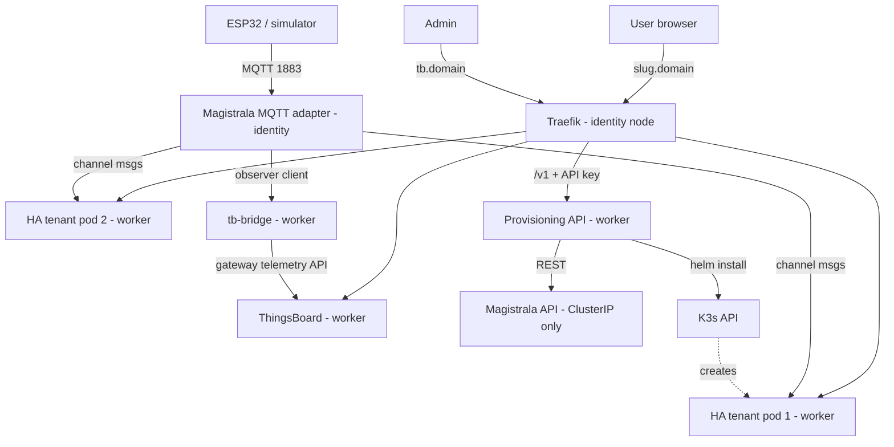
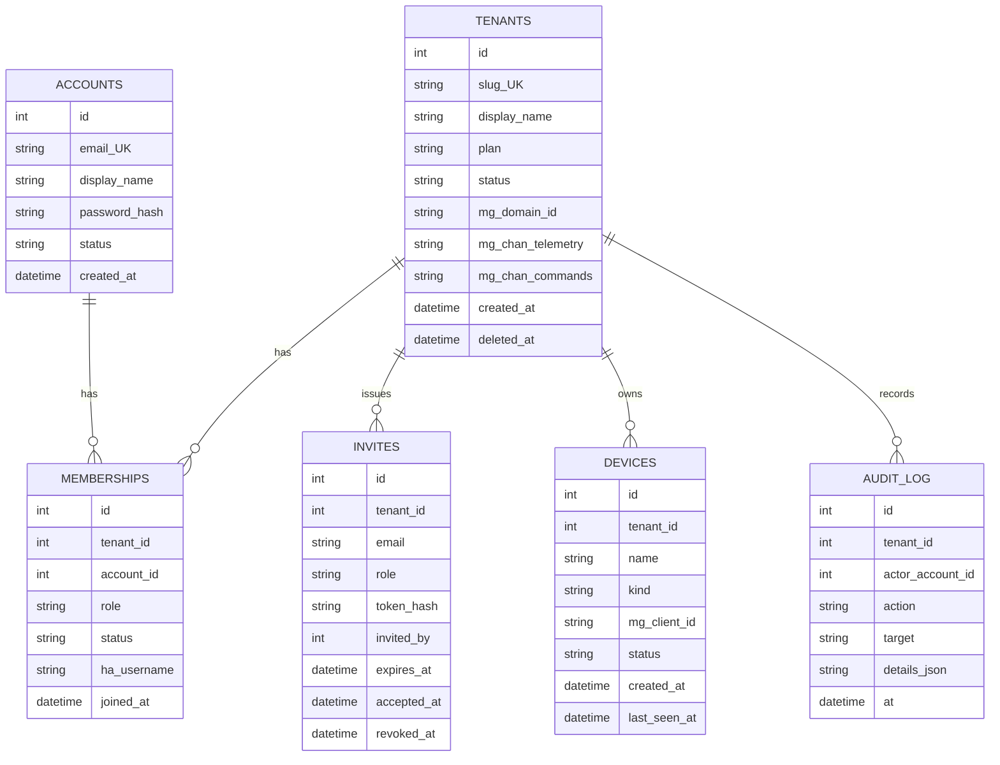

# SIFT — How It Works (living document)
Last updated: 2026-10-11 | Current phase: 3 | Environment: local

## 0. Status board
| Phase | Step | Status | Date | Commit |
|-------|------|--------|------|--------|
| 0 | 0.1 Check host | done | 2026-10-11 | phase-0.step-1 |
| 0 | 0.2 Install/verify tools | done | 2026-10-11 | phase-0.step-3 |
| 0 | 0.3 Create repo skeleton | done | 2026-10-11 | phase-0.step-3 |
| 0 | 0.4 Create HOW_IT_WORKS.md | done | 2026-10-11 | phase-0.step-3 |
| 0 | 0.5 Create demo-script.md | done | 2026-10-11 | phase-0.step-3 |
| 1 | 1.1–1.4 Cluster + DNS + Ingress | done | 2026-10-11 | phase-1.step-4 |
| 2 | 2.1–2.4 Baseline namespaces, PriorityClass, NetPol | done | 2026-10-11 | phase-2.step-4 |
| 3 | 3.1–3.6 Magistrala identity + MQTT | doing | 2026-10-11 | — |
| 4 | — | todo | — | — |
| 5 | — | todo | — | — |
| 6 | — | todo | — | — |
| 6B | — | todo | — | — |
| 7 | — | todo | — | — |
| 8 | — | todo | — | — |
| 9 | — | todo | — | — |
| 10 | — | todo | — | — |
| 11 | — | todo | — | — |
| 12 | — | todo | — | — |

## 1. System overview

SIFT (Scalable Isolated Framework for Things) is a multi-tenant IoT smart-home platform. Each "tenant" is a household that gets its own isolated Home Assistant instance, connected to shared infrastructure for device identity (Magistrala) and observability (ThingsBoard).

The platform runs on a 2-node K3s cluster (single control plane — NOT highly available):
- **Identity node** (server): runs K3s server, Traefik ingress, and Magistrala (MQTT broker + device identity/auth). This is the single point of failure for the cluster.
- **Worker node** (agent): runs ThingsBoard CE, per-tenant Home Assistant pods, the Provisioning API, and tb-bridge.

Two traffic paths exist:
1. **Humans** → `https://<slug>.<domain>` → Traefik → tenant's HA pod (each tenant gets `<slug>.localtest.me` locally)
2. **Devices** → MQTT :1883 → Magistrala MQTT adapter → authenticated, delivered to channel subscribers: the tenant's HA pod (HA is an MQTT client) and tb-bridge (observer client → ThingsBoard)

Tenants are isolated via: dedicated Kubernetes namespace, default-deny NetworkPolicy, ResourceQuota, LimitRange, ServiceAccount with no token automount, and Pod Security Standards (`baseline`).

## 2. Environment and pinned versions
| Component | Version/tag | Where used | Why this version |
|-----------|-------------|------------|------------------|
| Host OS | Windows 10/11 | Dev machine | User's OS |
| RAM | 21 GB | Host | Well above 16 GB recommended |
| CPU | 6 cores / 12 threads | Host | Sufficient for 2-node cluster |
| Docker Desktop | v29.7.2 (client+server), 10.62 GiB RAM | Container runtime | Latest stable installed |
| Git | 2.52.0 | Version control | Latest stable |
| Node.js | v24.18.0 LTS | Services (provisioning-api, tb-bridge, simulator) | LTS for stability |
| kubectl | v1.36.1 | K8s management | Matches K3s API version range |
| Helm | v4.1.4 | Chart management | Latest stable |
| k3d | v5.9.0 | Local K3s clusters | Latest stable via winget |
| K3s | v1.35.5+k3s1 | Cluster runtime | Default for k3d v5.9.0 |
| Magistrala | TBD (Phase 3) | Device identity + MQTT | Research gate in Phase 3 |
| ThingsBoard CE | TBD (Phase 4) | Observability dashboard | Research gate in Phase 4 |
| Home Assistant | TBD (Phase 5) | Tenant smart-home UI | Latest stable at time of Phase 5 |

## 3. Component reference

### 3.1 k3d / K3s cluster
- **Purpose**: Local Kubernetes cluster simulating 2 EC2 nodes via Docker containers
- **Where it runs**: Docker Desktop on Windows host
- **Key config**: 1 server + 1 agent, ports 80/443/1883 mapped, node labels `sift.io/role=identity` (server) and `sift.io/role=worker` (agent), memory limits 4g each
- **Why**: k3d wraps K3s in Docker containers, making it easy to create/destroy clusters locally. K3s is lightweight Kubernetes that includes Traefik and ServiceLB by default.
- **Data in/out**: n/a (infrastructure)
- **How to inspect**: `kubectl get nodes -o wide --show-labels`, `kubectl get pods -A`, `k3d cluster list`
- **Failure modes**: Single server node = single point of failure; losing it kills the control plane and MQTT. Worker node loss = tenant HA pods go Pending (if nodeSelector is hard) or reschedule (if soft affinity).
- **Verified by**: Phase 1

### 3.2 Traefik
- **Purpose**: Ingress controller routing HTTP/HTTPS traffic to tenant HA pods, ThingsBoard, and the Provisioning API based on hostname
- **Where it runs**: Identity node (kube-system namespace, bundled with K3s)
- **Key config**: Listens on 80/443 via ServiceLB. Wildcard `*.localtest.me` resolves to 127.0.0.1 for local dev.
- **Why**: Bundled with K3s, no extra install needed. Handles host-based routing and WebSocket (HA needs it).
- **Verified by**: Phase 1

### 3.2b Cluster Baseline Objects (Namespaces, PriorityClass, NetworkPolicy)
- **Namespaces**: `platform` (Magistrala MQTT/identity), `observability` (ThingsBoard CE), `provisioning` (Provisioning API + DB). Tenant namespaces (`tenant-<slug>`) are dynamically stamped out by Helm.
- **PriorityClass**: `identity-critical` (value `1000000`, `globalDefault: false`). Ensures Magistrala pods are never evicted in favor of tenant HA pods during memory/CPU pressure.
- **NetworkPolicy Template** (`cluster/netpol-tenant-template.yaml`):
  - `default-deny-all`: Denies all ingress and egress across the tenant namespace.
  - `allow-traefik-and-api-ingress`: Ingress to HA (:8123) permitted ONLY from pods with label `app.kubernetes.io/name=traefik` in `kube-system` and provisioning API.
  - `allow-dns-egress`: Permitted UDP/TCP 53 to CoreDNS in `kube-system`.
  - `allow-magistrala-mqtt-egress`: Permitted egress to Magistrala MQTT adapter port (:1883) in `platform`.
- **Enforcement Verification**: Verified K3s NetworkPolicy controller with 2 isolated namespaces. Before policy: HTTP 200. After default-deny: connection timed out (HTTP 000).
- **Verified by**: Phase 2

### 3.3 Magistrala
- UNVERIFIED — details to be filled in Phase 3 after research gate

### 3.4 ThingsBoard CE
- UNVERIFIED — details to be filled in Phase 4 after research gate

### 3.5 HA tenant chart
- UNVERIFIED — details to be filled in Phase 5

### 3.6 Provisioning API
- UNVERIFIED — details to be filled in Phase 6

### 3.7 tb-bridge
- UNVERIFIED — details to be filled in Phase 7

### 3.8 Simulator
- UNVERIFIED — details to be filled in Phase 8

## 4. Function and module reference

(Will be populated as code is written, starting Phase 6)

## 4b. Data model

### Product model
- **Tenant** = household account. Plans are config, not separate architecture.
- **Plans** (from `plans.json`):
  | Plan | Seats (incl. owner) | Devices |
  |------|---------------------|---------|
  | single | 1 | 10 |
  | family | 6 | 30 |
- **Roles**: owner (1 per tenant), admin, member. No viewer role (HA doesn't support per-user device permissions — D14).
- **Devices** belong to the tenant, never to a user. Two members of the same tenant both control all devices.

### Database schema (SQLite — decision D16)

Secrets (Magistrala client secrets, HA service tokens) are stored ONLY in Kubernetes Secrets in the `provisioning` namespace, never in the DB.

UNVERIFIED — full schema implementation in Phase 6B.

## 5. End-to-end flows

### 5.1 Tenant provisioning
UNVERIFIED — will be documented with sequence diagram in Phase 6.

### 5.2 Device telemetry
UNVERIFIED — will be documented in Phase 3 with real topic names.

### 5.3 Unauthorized device
UNVERIFIED — will be documented in Phase 3.

### 5.4 Node failure
UNVERIFIED — will be documented in Phase 10.

### 5.5 Invite and join
UNVERIFIED — will be documented in Phase 6B.

### 5.6 Device command (downlink)
UNVERIFIED — will be documented in Phase 6B.

### 5.7 Member removal
UNVERIFIED — will be documented in Phase 6B.

### 5.8 Plan change
UNVERIFIED — will be documented in Phase 6B.

## 6. Security model
| Threat | Control | Where implemented | Test id | Result |
|--------|---------|-------------------|---------|--------|
| Tenant-to-tenant pod access | default-deny NetworkPolicy per tenant namespace | Phase 2 / HA chart | T-ISO-1 | UNVERIFIED |
| Unauthorized device connection | Magistrala client auth (id + secret) | Phase 3 | T-AUTH-1 | UNVERIFIED |
| Cross-tenant MQTT | Per-tenant channels in Magistrala | Phase 3 | T-AUTH-2 | UNVERIFIED |
| K8s API access from tenant pod | ServiceAccount with automountServiceAccountToken: false | Phase 5 / HA chart | T-ISO-3 | UNVERIFIED |
| Provisioning API without auth | X-API-Key with constant-time compare | Phase 6 | T-API-1 | UNVERIFIED |
| Secret leakage in logs | Redaction in all log outputs | Phase 6 | T-API-2 | UNVERIFIED |
| IDOR (member of tenant A accessing B) | DB-based role check on every request | Phase 6B | T-MEM-1 | UNVERIFIED |
| Seat/device limit bypass via concurrency | BEGIN IMMEDIATE transaction in SQLite | Phase 6B | T-MEM-3 | UNVERIFIED |

## 7. Decisions log
| Date | Decision | Alternatives considered | Why |
|------|----------|------------------------|-----|
| 2026-10-11 | D1: Use Magistrala (not old Mainflux tutorials) | Following Mainflux docs | Mainflux was renamed; topic formats, auth model, chart names all changed |
| 2026-10-11 | D2: Tenant isolation = namespace + NetworkPolicy + ResourceQuota + LimitRange + SA + Pod Security | Just separate pods | Pods can talk to each other by default; full namespace isolation is required |
| 2026-10-11 | D3: HA receives data as MQTT client of Magistrala | Direct routing | HA has native MQTT integration; no custom protocol needed |
| 2026-10-11 | D4: tb-bridge forwards to ThingsBoard | ThingsBoard built-in integrations | TB CE has no built-in integrations (to verify) |
| 2026-10-11 | D5: ThingsBoard v1 = monolith with in-memory queue, no TimescaleDB | TimescaleDB, microservice mode | Adds RAM + complexity with no demo value |
| 2026-10-11 | D6: Expose via ServiceLB (type LoadBalancer) | NodePort | NodePort cannot use ports below 30000 by default |
| 2026-10-11 | D7: Magistrala admin API is ClusterIP only | Expose via Ingress | Reduce attack surface; only MQTT and Traefik are public |
| 2026-10-11 | D8: K3s local-path volumes are node-tied; no stateful failover claim | Claim automatic failover | Would be dishonest; local-path doesn't support multi-node |
| 2026-10-11 | D9: Single K3s server = SPOF; never write "highly available" | Imply HA | Would be dishonest for a 2-node single-control-plane setup |
| 2026-10-11 | D10: PriorityClass identity-critical on Magistrala | Equal priority | Magistrala must win over tenant pods if resources are scarce |
| 2026-10-11 | D11: Tenant = household account; single/family are plans of the same type | Separate architecture per plan | Same infra, different seat/device limits enforced by API |
| 2026-10-11 | D12: People are accounts; join tenants through memberships with roles | Users own devices | Devices belong to tenant, not user |
| 2026-10-11 | D13: Cross-tenant device sharing is a non-goal | Build a forwarder | Needs firmware changes; invite as member instead |
| 2026-10-11 | D14: HA has no per-user device permissions; no viewer role | Implement viewer | HA doesn't support it natively |
| 2026-10-11 | D15: Two channels per tenant (telemetry + commands) | Single channel | Prevent sensors from sending commands |
| 2026-10-11 | D16: SQLite for demo DB; secrets in K8s Secrets only | No database / Postgres | SQLite = zero extra RAM; Postgres for production later |

## 8. Measurements

(Will be populated starting Phase 3 with RAM baselines, Phase 8 with load test results)

## 9. Troubleshooting log
| Symptom | Root cause | Fix | Date |
|---------|-----------|-----|------|

## 10. Cost model

### Tier A — Demo (2-node K3s on AWS, us-east-1, on-demand)
| Item | Calculation | Monthly |
|------|-------------|---------|
| 2 x t3.medium | 2 × $30.37 | $60.74 |
| EBS gp3 2 × 30 GB | 60 × $0.08 | $4.80 |
| Public IPv4 × 2 | 2 × $3.65 | $7.30 |
| Data transfer | < 100 GB free | $0 |
| **Total (24/7)** | | **~$72.84** |

Stopped instances still cost ~$12/mo (EBS + IPv4). For ~22 days before 02 Nov 2026 running 24/7 ≈ $53. If Phase 10 shows node 2 needs 8 GB → +~$30/mo.

### Tier B — Production baseline (reference only)
~$293/mo — see SIFT_BUILD_PROMPT.md section 6.

### Tier C — 1,000 tenants (reference only)
EC2 bin-packing ~$7,950/mo vs Fargate ~$11,850/mo — see SIFT_BUILD_PROMPT.md section 6.

## 11. Known limitations and next steps

1. **Single control plane**: K3s server node is a SPOF. For production, need 3-node HA etcd cluster.
2. **No TLS on MQTT (local)**: Port 1883 is plaintext. Phase 11 (AWS) adds TLS on 8883.
3. **No persistent storage failover**: local-path PVs are node-bound.
4. **No Prometheus/Grafana**: Monitoring is manual (`kubectl top`). Production would need a real stack.
5. **HA has no per-user device permissions**: All members of a tenant control all devices.
6. **Cross-tenant device sharing is out of scope**: Devices belong to exactly one tenant.

## 12. Changelog
| Date | Phase.Step | What changed | Why |
|------|-----------|--------------|-----|
| 2026-10-11 | 0.3 | Created repo skeleton, .gitignore, .env.example | Initial scaffold |
| 2026-10-11 | 0.4 | Created HOW_IT_WORKS.md with sections 0-12 | Living document required by R5, R12 |
| 2026-10-11 | 0.5 | Created docs/demo-script.md (empty headings) | Placeholder for Phase 12 |
| 2026-10-11 | 1.4 | k3d 2-node cluster created, node labels set, DNS + ingress verified | Local K3s cluster operational |
| 2026-10-11 | 2.4 | Created baseline namespaces, identity-critical PriorityClass, tenant netpol template, verified K3s NetPol enforcement | Cluster baseline and zero-trust isolation proof |
