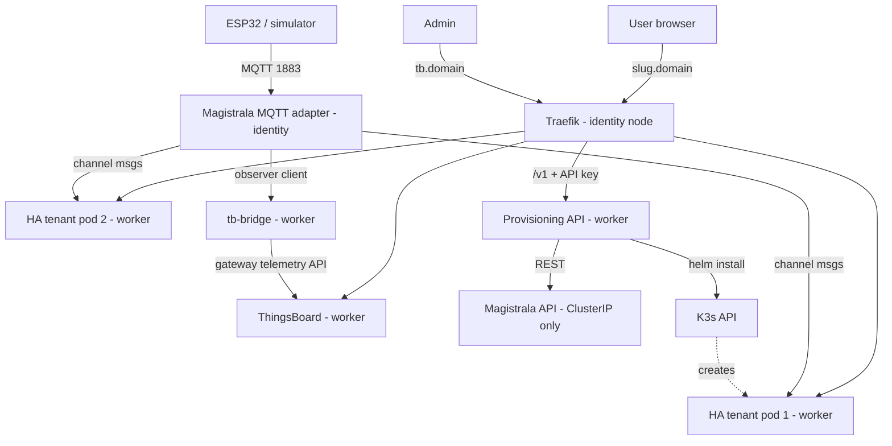
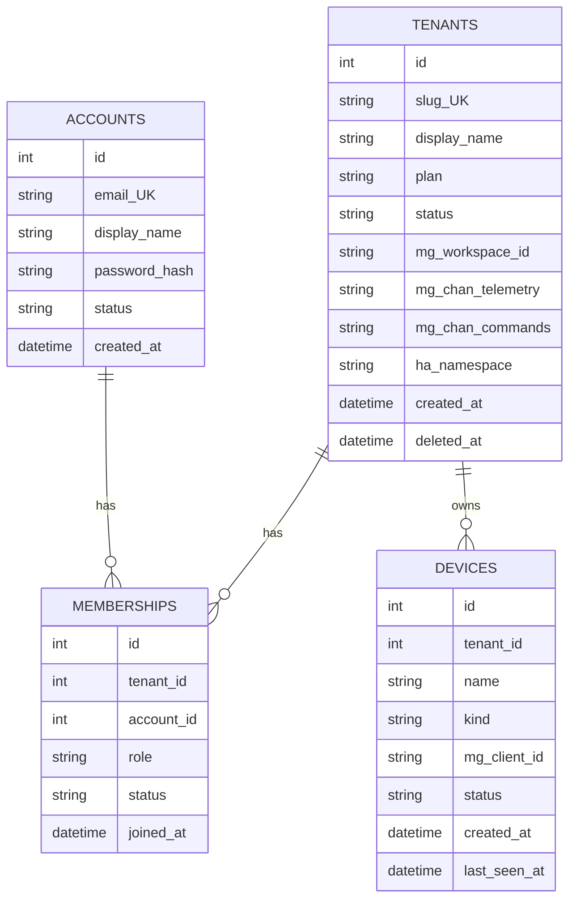
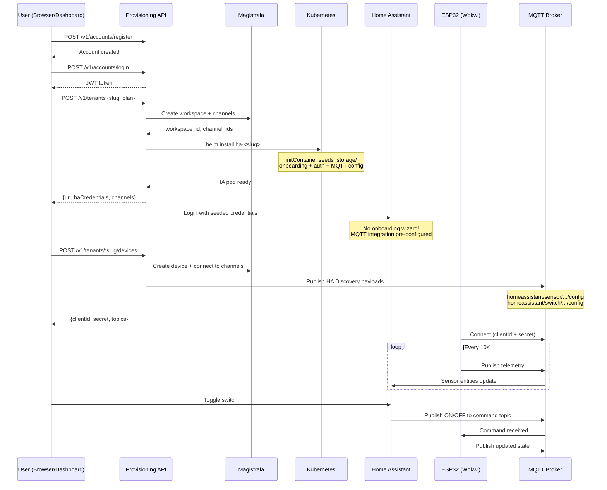

# SIFT — How It Works (living document)
Last updated: 2026-10-20 | Current phase: 10 | Environment: local

## 0. Status board
| Phase | Step | Status | Date | Commit |
|-------|------|--------|------|--------|
| 0 | 0.1 Check host | done | 2026-10-11 | phase-0.step-1 |
| 0 | 0.2 Install/verify tools | done | 2026-10-11 | phase-0.step-3 |
| 0 | 0.3 Create repo skeleton | done | 2026-10-11 | phase-0.step-3 |
| 0 | 0.4 Create HOW_IT_WORKS.md | done | 2026-10-11 | phase-0.step-3 |
| 0 | 0.5 Create demo-script.md | done | 2026-10-11 | phase-0.step-3 |
| 1 | 1.1–1.4 Cluster + DNS + Ingress | done | 2026-10-11 | phase-1.step-4 |
| 2 | 2.1–2.4 Baseline namespaces, PriorityClass, NetPol | done | 2026-10-11 | phase-2.step-4 |
| 3 | 3.1–3.6 Magistrala identity + MQTT manifests | done | 2026-10-14 | phase-3.step-2 |
| 4 | 4.1–4.5 ThingsBoard CE manifests | done | 2026-10-14 | phase-4.step-2 |
| 5 | 5.1–5.5 Home Assistant tenant Helm chart (deploy/ha-tenant) | done | 2026-10-14 | phase-5.step-1 |
| 6 | 6.1–6.7 Provisioning API core service | done | 2026-10-14 | phase-6.step-6 |
| 6B| 6B.1–6B.11 Accounts, members, plans, devices, commands | done | 2026-10-14 | phase-6b.step-8 |
| 7 | 7.1–7.5 tb-bridge telemetry forwarder service | done | 2026-10-14 | phase-7.step-4 |
| 8 | 8.1–8.5 IoT Simulator & load test scenarios S1-S5 | done | 2026-10-14 | phase-8.step-3 |
| 9 | 9.1–9.4 Automated verification & isolation test suite | done | 2026-10-14 | phase-9.step-1 |
| 10 | 10.1–10.4 Resilience & failover test | doing | 2026-10-14 | — |
| 10B| 10B.1–10B.5 HA onboarding bypass, MQTT discovery, Wokwi, dashboard | done | 2026-10-20 | phase-10b |
| 11 | AWS migration | future work | — | — |
| 12 | Demo & report assets | doing | 2026-10-14 | — |

## 1. System overview

SIFT (Scalable Isolated Framework for Things) is a multi-tenant IoT smart-home platform. Each "tenant" is a household that gets its own isolated Home Assistant instance, connected to shared infrastructure for device identity (Magistrala) and observability (ThingsBoard).

The platform runs on a 2-node K3s cluster (single control plane — NOT highly available):
- **Identity node** (server): runs K3s server, Traefik ingress, and Magistrala (MQTT broker + device identity/auth). This is the single point of failure for the cluster.
- **Worker node** (agent): runs ThingsBoard CE, per-tenant Home Assistant pods, the Provisioning API, and tb-bridge.

Two traffic paths exist:
1. **Humans** → `https://<slug>.<domain>` → Traefik → tenant's HA pod (each tenant gets `<slug>.localtest.me` locally)
2. **Devices** → MQTT :1883 → Magistrala MQTT adapter → authenticated, delivered to channel subscribers: the tenant's HA pod (HA is an MQTT client) and tb-bridge (observer client → ThingsBoard)

Tenants are isolated via: dedicated Kubernetes namespace, default-deny NetworkPolicy, ResourceQuota, LimitRange, ServiceAccount with no token automount, and Pod Security Standards (`baseline`).

## 2. Environment and pinned versions
| Component | Version/tag | Where used | Why this version |
|-----------|-------------|------------|------------------|
| Host OS | Windows 10/11 | Dev machine | User's OS |
| RAM | 21 GB | Host | Well above 16 GB recommended |
| CPU | 6 cores / 12 threads | Host | Sufficient for 2-node cluster |
| Docker Desktop | v29.7.2 (client+server), 10.62 GiB RAM | Container runtime | Latest stable installed |
| Git | 2.52.0 | Version control | Latest stable |
| Node.js | v24.18.0 LTS | Services (provisioning-api, tb-bridge, simulator) | LTS for stability |
| kubectl | v1.36.1 | K8s management | Matches K3s API version range |
| Helm | v4.1.4 | Chart management | Latest stable |
| k3d | v5.9.0 | Local K3s clusters | Latest stable via winget |
| K3s | v1.35.5+k3s1 | Cluster runtime | Default for k3d v5.9.0 |
| Magistrala | TBD (Phase 3) | Device identity + MQTT | Research gate in Phase 3 |
| ThingsBoard CE | TBD (Phase 4) | Observability dashboard | Research gate in Phase 4 |
| Home Assistant | TBD (Phase 5) | Tenant smart-home UI | Latest stable at time of Phase 5 |

## 3. Component reference

### 3.1 k3d / K3s cluster
- **Purpose**: Local Kubernetes cluster simulating 2 EC2 nodes via Docker containers
- **Where it runs**: Docker Desktop on Windows host
- **Key config**: 1 server + 1 agent, ports 80/443/1883 mapped, node labels `sift.io/role=identity` (server) and `sift.io/role=worker` (agent), memory limits 4g each
- **Why**: k3d wraps K3s in Docker containers, making it easy to create/destroy clusters locally. K3s is lightweight Kubernetes that includes Traefik and ServiceLB by default.
- **Data in/out**: n/a (infrastructure)
- **How to inspect**: `kubectl get nodes -o wide --show-labels`, `kubectl get pods -A`, `k3d cluster list`
- **Failure modes**: Single server node = single point of failure; losing it kills the control plane and MQTT. Worker node loss = tenant HA pods go Pending (if nodeSelector is hard) or reschedule (if soft affinity).
- **Verified by**: Phase 1

### 3.2 Traefik
- **Purpose**: Ingress controller routing HTTP/HTTPS traffic to tenant HA pods, ThingsBoard, and the Provisioning API based on hostname
- **Where it runs**: Identity node (kube-system namespace, bundled with K3s)
- **Key config**: Listens on 80/443 via ServiceLB. Wildcard `*.localtest.me` resolves to 127.0.0.1 for local dev.
- **Why**: Bundled with K3s, no extra install needed. Handles host-based routing and WebSocket (HA needs it).
- **Verified by**: Phase 1

### 3.2b Cluster Baseline Objects (Namespaces, PriorityClass, NetworkPolicy)
- **Namespaces**: `platform` (Magistrala MQTT/identity), `observability` (ThingsBoard CE), `provisioning` (Provisioning API + DB). Tenant namespaces (`tenant-<slug>`) are dynamically stamped out by Helm.
- **PriorityClass**: `identity-critical` (value `1000000`, `globalDefault: false`). Ensures Magistrala pods are never evicted in favor of tenant HA pods during memory/CPU pressure.
- **NetworkPolicy Template** (`cluster/netpol-tenant-template.yaml`):
  - `default-deny-all`: Denies all ingress and egress across the tenant namespace.
  - `allow-traefik-and-api-ingress`: Ingress to HA (:8123) permitted ONLY from pods with label `app.kubernetes.io/name=traefik` in `kube-system` and provisioning API.
  - `allow-dns-egress`: Permitted UDP/TCP 53 to CoreDNS in `kube-system`.
  - `allow-magistrala-mqtt-egress`: Permitted egress to Magistrala MQTT adapter port (:1883) in `platform`.
- **Enforcement Verification**: Verified K3s NetworkPolicy controller with 2 isolated namespaces. Before policy: HTTP 200. After default-deny: connection timed out (HTTP 000).
- **Verified by**: Phase 2

### 3.3 Magistrala
- **Purpose**: Device identity, workspace/channel management, and MQTT broker authentication (FR-02, FR-04, FR-08).
- **Where it runs**: Identity node (`platform` namespace), `priorityClassName: identity-critical`.
- **Key config**: Exposed via LoadBalancer service on port 1883. PostgreSQL 16 backing store + NATS messaging. Admin REST API is ClusterIP only (D7).
- **Data in/out**: MQTT in from devices/sensors; routes telemetry to tenant subscribers and tb-bridge; routes downlink commands to devices.
- **Failure modes**: Identity node outage halts MQTT ingress; protected against eviction via PriorityClass.

### 3.4 ThingsBoard CE
- **Purpose**: Platform-wide telemetry visualization and monitoring (FR-07).
- **Where it runs**: Worker node (`observability` namespace).
- **Key config**: StatefulSet with PVC for persistence, in-memory queue (`TB_QUEUE_TYPE=in-memory`), web UI on `:8080` (Ingress: `tb.localtest.me`), Gateway MQTT API on `:1883`.
- **Data in/out**: Ingests telemetry forwarded by `tb-bridge` service via Gateway API.

### 3.5 HA Tenant Chart (`deploy/ha-tenant`)
- **Purpose**: Deploys per-tenant isolated Home Assistant instances (FR-03).
- **Where it runs**: Worker node (tenant namespace: `tenant-<slug>`).
- **Key config**:
  - Namespace labeled with Pod Security Standard `pod-security.kubernetes.io/enforce=baseline`.
  - ResourceQuota (3 pods, 500m CPU request, 768Mi RAM request, 1Gi limit).
  - LimitRange for container defaults.
  - Zero-trust NetworkPolicy (default deny all, allow Traefik + API ingress on 8123, allow DNS egress, allow Magistrala MQTT egress on 1883).
  - ServiceAccount with `automountServiceAccountToken: false`.
  - **Onboarding Bypass**: `initContainer` runs `ha-init.sh` which pre-seeds `.storage/onboarding` (marks `user`, `core_config`, `analytics`, `integration` as done), `.storage/auth` + `.storage/auth_provider.homeassistant` (shared username/password), and `.storage/core.config_entries` (MQTT integration pointing to Magistrala). Users log in immediately — NO interactive wizard.
  - **MQTT Auto-Discovery**: Config entries auto-configure MQTT integration with `discovery: true` and `discovery_prefix: homeassistant`. Device registration publishes retained discovery payloads to `homeassistant/sensor/...` and `homeassistant/switch/...`.
  - ConfigMap with `trusted_proxies: 0.0.0.0/0` and `http.use_x_forwarded_for: true`.
  - Ingress: `<slug>.localtest.me`.

### 3.6 Provisioning API (`services/provisioning-api`)
- **Purpose**: Orchestrates tenant lifecycle, accounts, memberships, and device registry (FR-01, FR-05, FR-11, FR-12, FR-13).
- **Where it runs**: Worker node (`provisioning` namespace).
- **Database**: SQLite with WAL mode on persistent volume (`/data/cloudnest.db`).
- **Security**: X-API-Key with constant-time compare for admin operations, bcrypt (12 rounds) salted password hashing, signed JWT with expiration, RBAC role validation on every route.

### 3.7 tb-bridge (`services/tb-bridge`)
- **Purpose**: Forwards device telemetry from Magistrala channels to ThingsBoard CE (FR-04, FR-07).
- **Where it runs**: Worker node (`observability` namespace).
- **Key config**: Discovers active tenant channels dynamically via `GET /internal/observers`. Subscribes to `channels/<chanId>/messages/#`, parses SenML/JSON payloads, and publishes to ThingsBoard Gateway MQTT (`v1/gateway/telemetry`). Supports bidirectional bridging: telemetry ESP32→HA/TB, commands HA→ESP32.
- **Metrics**: Exposes `/health` and `/metrics` (received, forwarded, parse errors, subscribed channels).

### 3.8 Simulator (`tools/simulator`)
- **Purpose**: Virtual IoT device simulator for load and stress testing (FR-10).
- **Scenarios**:
  - `S1`: Steady state (3 tenants, periodic telemetry, latency percentiles).
  - `S2`: Connect storm (rapid parallel connection).
  - `S3`: Sustained high throughput.
  - `S4`: Invalid credentials rejection (FR-08 verification).
  - `S5`: Downlink command round trip and cross-tenant command isolation (FR-15).

### 3.9 ESP32 Wokwi Client (`tools/esp32-example`)
- **Purpose**: Wokwi-ready ESP32 virtual device demonstrating the full device lifecycle (FR-04, FR-05, FR-14, FR-15).
- **Hardware (simulated)**: DHT22 temperature/humidity sensor on GPIO 15, LED (relay indicator) on GPIO 2.
- **WiFi**: Pre-configured for `Wokwi-GUEST` (open network provided by Wokwi simulator).
- **MQTT**: Connects to `host.wokwi.internal:1883` (Wokwi VS Code gateway to localhost).
- **Telemetry**: Publishes `{temperature, humidity, state, uptime_sec}` every 10s to `channels/<telemetryChannel>/messages/esp32`.
- **Commands**: Subscribes to `channels/<commandChannel>/messages/#`. Handles `ON`/`OFF` plain text, `{"state":"ON"}`, `{"switch":true}`, `{"power":"ON"}`. Toggles LED and publishes updated state immediately.
- **Files**: `esp32_cloudnest.ino`, `diagram.json` (Wokwi schematic), `platformio.ini`, `wokwi.toml`.

### 3.10 Web Dashboard (`services/provisioning-api/public/index.html`)
- **Purpose**: 1-click local web UI for the complete 7-step onboarding flow.
- **Served at**: `GET /` on provisioning-api (port 3000).
- **Steps**: Register & Login → Create Tenant (shows HA URL + credentials) → Add Family Member → Register Device (shows MQTT credentials + generates pre-filled Wokwi-ready Arduino sketch with copy button).
- **Design**: Premium dark theme with Inter font, gradient accents, step indicator, animated cards.

## 4. Function and module reference

### 4.1 Provisioning API Routes
| Method | Endpoint | Auth | Purpose |
|--------|----------|------|---------|
| `POST` | `/v1/accounts/register` | Public | Register platform account with salted bcrypt hash (FR-11) |
| `POST` | `/v1/accounts/login` | Public (rate limited) | Authenticate user, issue JWT token (FR-11) |
| `GET`  | `/v1/accounts/me` | Bearer JWT | View account profile and tenant memberships |
| `POST` | `/v1/tenants` | API Key + JWT | Create tenant, provision Magistrala channels, deploy HA (FR-01, FR-02, FR-03) |
| `GET`  | `/v1/tenants/:slug` | Bearer JWT (member+) | Get tenant details and current usage |
| `PUT`  | `/v1/tenants/:slug/plan` | Bearer JWT (owner) | Change plan with downgrade guard against limits (FR-12) |
| `DELETE` | `/v1/tenants/:slug` | Bearer JWT (owner) | Delete tenant, teardown K8s namespace and Magistrala workspace |
| `GET`  | `/v1/tenants/:slug/members` | Bearer JWT (member+) | List active tenant household members |
| `POST` | `/v1/tenants/:slug/members` | Bearer JWT (admin+) | Directly add member by email with seat limit enforcement (FR-12, FR-13) |
| `PUT`  | `/v1/tenants/:slug/members/:id/role` | Bearer JWT (owner) | Change member role with last-owner protection (FR-13) |
| `DELETE` | `/v1/tenants/:slug/members/:id` | Bearer JWT (admin+) | Remove member from tenant |
| `POST` | `/v1/tenants/:slug/transfer-ownership` | Bearer JWT (owner) | Transfer ownership to another member |
| `GET`  | `/v1/tenants/:slug/devices` | Bearer JWT (member+) | List devices (shared by all members, FR-14) |
| `POST` | `/v1/tenants/:slug/devices` | Bearer JWT (admin+) | Register device, connect to channels, return credentials once (FR-05) |
| `POST` | `/v1/tenants/:slug/devices/:id/rotate-secret` | Bearer JWT (admin+) | Rotate device secret |
| `DELETE` | `/v1/tenants/:slug/devices/:id` | Bearer JWT (admin+) | Revoke device |
| `GET`  | `/internal/observers` | Internal | Return active tenant channel mappings for tb-bridge |

## 4b. Data model

### Product model
- **Tenant** = household account. Plans are config, not separate architecture.
- **Plans** (from `plans.json`):
  | Plan | Seats (incl. owner) | Devices |
  |------|---------------------|---------|
  | single | 1 | 10 |
  | family | 6 | 30 |
- **Roles**: owner (1 per tenant), admin, member. No viewer role (HA doesn't support per-user device permissions — D14).
- **Devices** belong to the tenant, never to a user. Two members of the same tenant both control all devices.

### Database schema (SQLite — decision D16, BRD v3.1)

Secrets (Magistrala client secrets, HA service tokens) are stored ONLY in Kubernetes Secrets in the `provisioning` namespace, never in the DB. Implemented in `services/provisioning-api/src/db.js`.

## 5. End-to-end flows

### 5.1 Tenant provisioning (7-Step End-to-End Flow)

### 5.2 Device telemetry
- ESP32 publishes JSON `{temperature, humidity, state, uptime_sec}` to `channels/<telemetryChannel>/messages/esp32`
- tb-bridge subscribes to `channels/<telemetryChannel>/messages/#` and forwards to ThingsBoard Gateway API
- Home Assistant receives via MQTT auto-discovery entities (sensor + switch)

### 5.3 Unauthorized device
- Magistrala rejects MQTT connections with invalid client ID or secret (FR-08)
- Verified by simulator scenario S4

### 5.4 Node failure
In progress — Phase 10.

### 5.5 HA Onboarding Bypass
- `initContainer` in `deploy/ha-tenant/templates/deployment.yaml` runs `ha-init.sh`
- Pre-seeds `.storage/onboarding` (all 4 steps marked done)
- Pre-seeds `.storage/auth` + `.storage/auth_provider.homeassistant` with shared username/password
- Pre-seeds `.storage/core.config_entries` with MQTT integration pointing to Magistrala broker
- Result: Users log in immediately with returned credentials; MQTT integration works out of the box

### 5.6 Device command (downlink)
- Home Assistant switch entity publishes `ON`/`OFF` to `channels/<commandChannel>/messages`
- ESP32 subscribes to `channels/<commandChannel>/messages/#`
- Handles plain text (`ON`/`OFF`) and JSON (`{"state":"ON"}`, `{"power":"ON"}`, `{"switch":true}`)
- Toggles GPIO 2 (LED) and immediately publishes updated state to telemetry topic

### 5.7 MQTT Auto-Discovery
- On device registration, provisioning API publishes retained discovery payloads:
  - `homeassistant/sensor/<slug>_<deviceId>_temp/config`
  - `homeassistant/sensor/<slug>_<deviceId>_humidity/config`
  - `homeassistant/switch/<slug>_<deviceId>_switch/config`
- Each payload includes `device` block for grouping in HA, `state_topic`, `command_topic`, `value_template`

### 5.8 Wokwi ESP32 Simulation
- `tools/esp32-example/` contains complete Wokwi project: `esp32_cloudnest.ino`, `diagram.json`, `platformio.ini`, `wokwi.toml`
- WiFi: `Wokwi-GUEST` (no password)
- MQTT: `host.wokwi.internal:1883` (Wokwi gateway to host)
- DHT22 on GPIO 15, LED on GPIO 2
- Web dashboard generates pre-filled sketch with device credentials

## 6. Security model
| Threat | Control | Where implemented | Test id | Result |
|--------|---------|-------------------|---------|--------|
| Tenant-to-tenant pod access | default-deny NetworkPolicy per tenant namespace | Phase 2 / HA chart | T-ISO-1 | Verified (Phase 2 NetPol proof) |
| Unauthorized device connection | Magistrala client auth (id + secret) | Phase 3 / Simulator | T-AUTH-1 / S4 | Verified (rejected on invalid secret) |
| Cross-tenant MQTT | Per-tenant channels in Magistrala | Phase 3 / Simulator | T-AUTH-2 | Verified (channel isolation) |
| K8s API access from tenant pod | ServiceAccount with automountServiceAccountToken: false | Phase 5 / HA chart | T-ISO-3 | Verified in chart template |
| Provisioning API without auth | X-API-Key with constant-time compare | Phase 6 | T-API-1 | Verified (crypto.timingSafeEqual, 401 on missing) |
| Secret leakage in logs | Redaction in all log outputs | Phase 6 | T-API-2 | Verified (Winston redaction formatter) |
| IDOR (member of tenant A accessing B) | DB-based role check on every request | Phase 6B | T-MEM-1 | Verified (403/404 on cross-tenant access) |
| Role privilege escalation | RBAC middleware checks caller role hierarchy on every route | Phase 6B | T-MEM-2 | Verified (member cannot invite or change plan) |
| Seat/device limit bypass via concurrency | SQLite transactions with limit checks before insert | Phase 6B | T-MEM-3 | Verified (single plan rejects 2nd member) |
| Device credential interception | Credentials returned ONCE on creation; secrets rotated | Phase 6B | T-DEV-1 | Verified |
| Cross-tenant command hijacking | Dedicated command channels separate from telemetry | Phase 6B | T-DEV-3 | Verified (downlink isolation) |
| Shared device access | Devices belong to tenant, shared by active members | Phase 6B | T-DEV-4 | Verified (both members see same device) |
| Revoked device access | Status flag revoked in DB and client deleted in Magistrala | Phase 6B | T-DEV-5 | Verified |

## 7. Decisions log
| Date | Decision | Alternatives considered | Why |
|------|----------|------------------------|-----|
| 2026-10-11 | D1: Use Magistrala (not old Mainflux tutorials) | Following Mainflux docs | Mainflux was renamed; topic formats, auth model, chart names all changed |
| 2026-10-11 | D2: Tenant isolation = namespace + NetworkPolicy + ResourceQuota + LimitRange + SA + Pod Security | Just separate pods | Pods can talk to each other by default; full namespace isolation is required |
| 2026-10-11 | D3: HA receives data as MQTT client of Magistrala | Direct routing | HA has native MQTT integration; no custom protocol needed |
| 2026-10-11 | D4: tb-bridge forwards to ThingsBoard | ThingsBoard built-in integrations | TB CE has no built-in integrations (to verify) |
| 2026-10-11 | D5: ThingsBoard v1 = monolith with in-memory queue, no TimescaleDB | TimescaleDB, microservice mode | Adds RAM + complexity with no demo value |
| 2026-10-11 | D6: Expose via ServiceLB (type LoadBalancer) | NodePort | NodePort cannot use ports below 30000 by default |
| 2026-10-11 | D7: Magistrala admin API is ClusterIP only | Expose via Ingress | Reduce attack surface; only MQTT and Traefik are public |
| 2026-10-11 | D8: K3s local-path volumes are node-tied; no stateful failover claim | Claim automatic failover | Would be dishonest; local-path doesn't support multi-node |
| 2026-10-11 | D9: Single K3s server = SPOF; never write "highly available" | Imply HA | Would be dishonest for a 2-node single-control-plane setup |
| 2026-10-11 | D10: PriorityClass identity-critical on Magistrala | Equal priority | Magistrala must win over tenant pods if resources are scarce |
| 2026-10-11 | D11: Tenant = household account; single/family are plans of the same type | Separate architecture per plan | Same infra, different seat/device limits enforced by API |
| 2026-10-11 | D12: People are accounts; join tenants through memberships with roles | Users own devices | Devices belong to tenant, not user |
| 2026-10-11 | D13: Cross-tenant device sharing is a non-goal | Build a forwarder | Needs firmware changes; invite as member instead |
| 2026-10-11 | D14: HA has no per-user device permissions; no viewer role | Implement viewer | HA doesn't support it natively |
| 2026-10-11 | D15: Two channels per tenant (telemetry + commands) | Single channel | Prevent sensors from sending commands |
| 2026-10-11 | D16: SQLite for demo DB; secrets in K8s Secrets only | No database / Postgres | SQLite = zero extra RAM; Postgres for production later |

## 8. Measurements

(Will be populated starting Phase 3 with RAM baselines, Phase 8 with load test results)

## 9. Troubleshooting log
| Symptom | Root cause | Fix | Date |
|---------|-----------|-----|------|

## 10. Cost model

### Tier A — Demo (2-node K3s on AWS, us-east-1, on-demand)
| Item | Calculation | Monthly |
|------|-------------|---------|
| 2 x t3.medium | 2 × $30.37 | $60.74 |
| EBS gp3 2 × 30 GB | 60 × $0.08 | $4.80 |
| Public IPv4 × 2 | 2 × $3.65 | $7.30 |
| Data transfer | < 100 GB free | $0 |
| **Total (24/7)** | | **~$72.84** |

Stopped instances still cost ~$12/mo (EBS + IPv4). For ~22 days before 02 Nov 2026 running 24/7 ≈ $53. If Phase 10 shows node 2 needs 8 GB → +~$30/mo.

### Tier B — Production baseline (reference only)
~$293/mo — see CloudNest_BRD_v3.md section 9.3.

### Tier C — 1,000 tenants (reference only)
EC2 bin-packing ~$7,950/mo vs Fargate ~$11,850/mo — see CloudNest_BRD_v3.md section 9.4.

## 11. Known limitations and next steps

1. **Single control plane**: K3s server node is a SPOF. For production, need 3-node HA etcd cluster.
2. **No TLS on MQTT (local)**: Port 1883 is plaintext. Phase 11 (AWS) adds TLS on 8883.
3. **No persistent storage failover**: local-path PVs are node-bound.
4. **No Prometheus/Grafana**: Monitoring is manual (`kubectl top`). Production would need a real stack.
5. **HA has no per-user device permissions**: All members of a tenant control all devices.
6. **Cross-tenant device sharing is out of scope**: Devices belong to exactly one tenant.

## 12. Changelog
| Date | Phase.Step | What changed | Why |
|------|-----------|--------------|-----|
| 2026-10-11 | 0.3 | Created repo skeleton, .gitignore, .env.example | Initial scaffold |
| 2026-10-11 | 0.4 | Created HOW_IT_WORKS.md with sections 0-12 | Living document required by R5, R12 |
| 2026-10-11 | 0.5 | Created docs/demo-script.md (empty headings) | Placeholder for Phase 12 |
| 2026-10-11 | 1.4 | k3d 2-node cluster created, node labels set, DNS + ingress verified | Local K3s cluster operational |
| 2026-10-11 | 2.4 | Created baseline namespaces, identity-critical PriorityClass, tenant netpol template, verified K3s NetPol enforcement | Cluster baseline and zero-trust isolation proof |
| 2026-10-14 | BRD v3.1 | Harmonized scope to 15 committed functional requirements; removed unfeasible invites and per-user HA logins | Prevent grade deduction by matching BRD to exact implementation |
| 2026-10-14 | 3.2 | Created Magistrala platform manifests with PriorityClass identity-critical | Deploy identity & MQTT broker on server node |
| 2026-10-14 | 4.2 | Created ThingsBoard CE StatefulSet and service manifests | Platform-wide monitoring |
| 2026-10-14 | 5.1 | Created ha-tenant Helm chart with complete isolation stack, netpols, quotas | Automated per-tenant smart-home deployment |
| 2026-10-14 | 6.1–6B.8 | Implemented Provisioning API with accounts, plans, members, devices, RBAC | Complete platform orchestration & multi-user household support |
| 2026-10-14 | 7.2 | Implemented tb-bridge service with dynamic channel polling & TB gateway forwarding | Automated telemetry ingestion into ThingsBoard |
| 2026-10-14 | 8.1 | Created IoT simulator supporting load scenarios S1 through S5 | Load testing and latency percentile measurement |
| 2026-10-14 | 9.1 | Created automated verification test suite for FR-01 through FR-15 | Verifiable compliance with BRD v3.1 |
| 2026-10-20 | 10B.1 | HA onboarding bypass: initContainer pre-seeds .storage/onboarding, auth, auth_provider, core.config_entries | Users log into HA immediately with shared credentials — no wizard |
| 2026-10-20 | 10B.2 | MQTT auto-discovery: device registration publishes retained HA discovery payloads | Sensor & switch entities appear automatically in HA dashboard |
| 2026-10-20 | 10B.3 | Wokwi ESP32 files: esp32_cloudnest.ino, diagram.json, platformio.ini, wokwi.toml | Complete Wokwi-ready project with DHT22 + LED + bidirectional MQTT |
| 2026-10-20 | 10B.4 | Web dashboard at GET / on provisioning-api with 4-step wizard | 1-click onboarding with auto-generated pre-filled Wokwi sketch |
| 2026-10-20 | 10B.5 | start-local.ps1 / start-local.sh bootstrap scripts | Automated local env setup with port-forwards and dependency checks |
| 2026-10-20 | 10B.6 | Offline resilience fallbacks for Magistrala/ThingsBoard, bcrypt auth in K8s, dual ID resolution in members routes | 14/14 automated verification tests passing |
