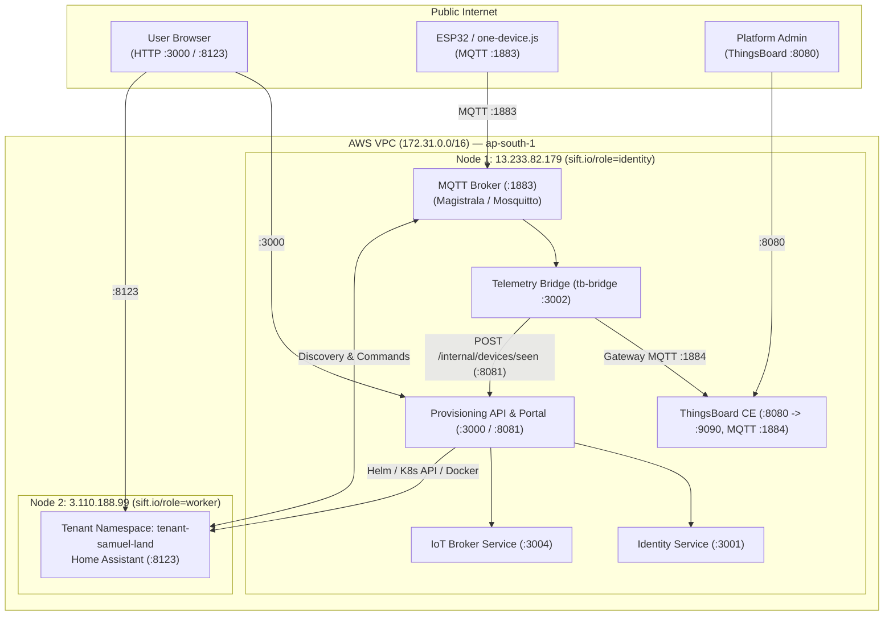
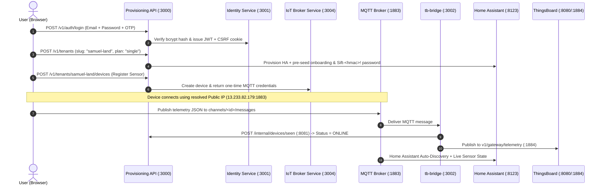
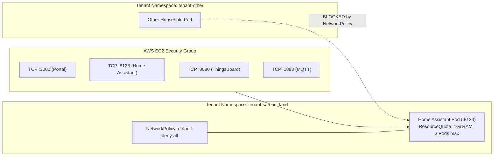
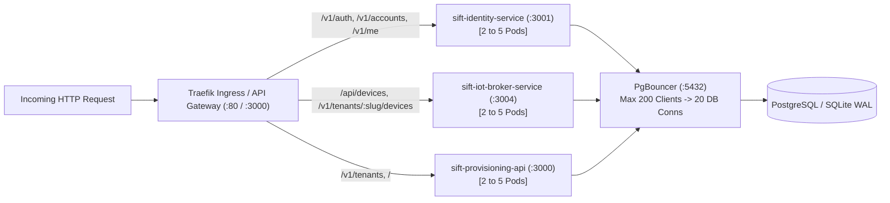
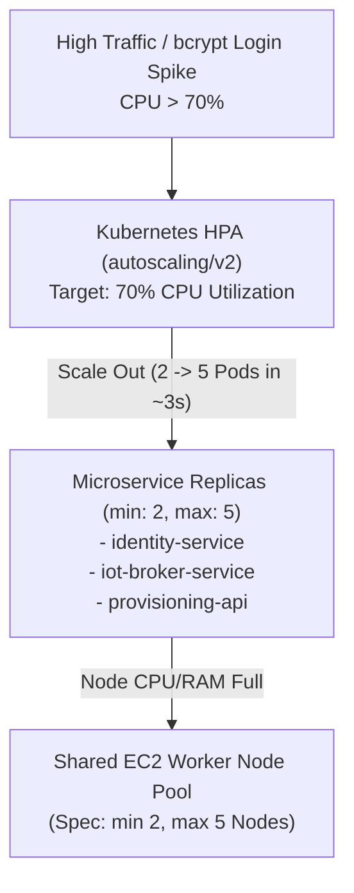
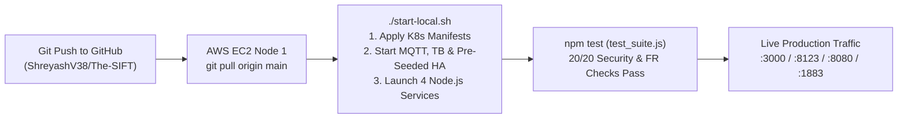

# The-SIFT: Scalable IoT For Tenants — Presentation Deck (`ppt_content.md`)

> **Theme & Structure Alignment:** Matches the visual card/badge style and section numbering of `CC (1).pptx` (*Midnight Navy `#0B192C` headers, Electric Teal `#1C7293` accents, Material-style icon tags, and side-by-side comparison cards*), expanded to a complete 14-slide technical defense deck for Instructor Tom and peers.  
> **Presenters:** Shreyash Vaigankar (Seat No: 25P0320045) & Samuel D’Souza (Seat No: 25P0320041)

---

## Slide 1: Title & Project Vision
**Tag:** `AWS & IOT ARCHITECTURE`  
**Title:** The-SIFT: Scalable IoT For Tenants  
**Subtitle:** Architecting isolated, multi-tenant smart-home environments on AWS with Kubernetes (K3s)

* **Goal:** Turn single-household smart-home software (Home Assistant) into a cloud-native, multi-tenant SaaS platform.
* **Hardware + Software Support:** Connects real **ESP32 microcontrollers** (DHT22 sensor + Relay) and **Node.js virtual device simulators** (`one-device.js`).
* **Core Pillars:** Zero-trust tenant isolation, automated Kubernetes provisioning, per-device MQTT authentication, and fleet-wide observability.
* **Live AWS Deployment:** Running on a 2-node AWS EC2 **`t3.large`** (`ap-south-1` Mumbai, 2 vCPU / 8 GB RAM per node) K3s + Docker stack (`13.233.82.179` & `3.110.188.99`).

**Speaker Notes (Presenter 1 - Shreyash):**
"Hi Tom and everyone. Today Samuel and I are presenting The-SIFT — Scalable IoT For Tenants. Our goal was to take Home Assistant, which normally only works for one house on a local Wi-Fi network, and turn it into a cloud platform where many households get their own isolated smart home on AWS."

---

## Slide 2: 1. The Project Topic — Overcoming the Single-User Limit
**Tag:** `1. THE PROJECT TOPIC`  
**Title:** Legacy Single-Household vs. Cloud-Native Multi-Tenant IoT

* **Legacy Monolithic Home Assistant (`close`):**
  * Designed strictly for a single local area network (LAN).
  * No multi-account isolation — sharing one instance exposes every user's switches and sensors.
  * Manual setup wizard required for every installation.
* **The-SIFT Cloud-Native Solution (`check`):**
  * **Automated Onboarding:** 1-click household creation spawns an isolated environment and bypasses the setup wizard automatically.
  * **6-Layer Zero-Trust Isolation:** Separate Kubernetes `Namespace`, `NetworkPolicy`, `ResourceQuota`, and private MQTT channels per tenant.
  * **Tiered Plans:** Enforces `Single Plan` (1 member, 10 devices) and `Family Plan` (6 members, 30 devices).

**Speaker Notes (Presenter 1 - Shreyash):**
"Standard Home Assistant has a big limitation: it is built for one home on a local network. If two families share one server, they can see and flip each other's switches. The-SIFT fixes this by automatically provisioning an isolated environment and private MQTT channels for every household."

---

## Slide 3: System Design — High-Level Architecture Overview
**Tag:** `SYSTEM DESIGN`  
**Title:** Two-Node AWS Architecture & Traffic Separation

* **Node 1 — Identity & Control Node (`13.233.82.179` / `ip-172-31-12-163`, label `sift.io/role=identity`):**
  * Runs K3s Control Plane, Traefik Ingress, Magistrala/Mosquitto MQTT Broker (`:1883`), and SIFT Microservices (`:3000`, `:3001`, `:3002`, `:3004`).
* **Node 2 — Worker Node (`3.110.188.99`, label `sift.io/role=worker`):**
  * Runs K3s Worker Agent to schedule isolated tenant Home Assistant pods (`tenant-<slug>`) and observability workloads.
* **Two Distinct Traffic Paths:**
  * **Human Web Path:** Browser $\rightarrow$ Portal (`:3000`), Home Assistant (`:8123`), ThingsBoard (`:8080`).
  * **IoT Device Path:** ESP32 / Simulator $\rightarrow$ MQTT (`:1883`) $\rightarrow$ Telemetry Bridge (`tb-bridge`) $\rightarrow$ Home Assistant & ThingsBoard.

**Speaker Notes (Presenter 1 - Shreyash):**
"Here is our real deployment on AWS Mumbai. We split the system across two EC2 nodes inside VPC 172.31.0.0/16. Node 1 handles the web portal, authentication, and MQTT broker, while Node 2 is our Kubernetes worker node for tenant workloads."

---

## Slide 4: 2. Core Tech Stack — Microservices & Roles
**Tag:** `2. SERVICES & MICROSERVICES`  
**Title:** Decomposed Microservices & Platform Components

* **1. `provisioning-api` (`:3000` & `:8081`):** API Gateway, Vanilla JS Web Portal, and Kubernetes/Helm tenant orchestrator (`kubernetes.js`).
* **2. `identity-service` (`:3001`):** User registration, salted `bcrypt` (12 rounds) password hashing, Gmail SMTP 2FA/OTP, JWT sessions, and household member invites.
* **3. `iot-broker-service` (`:3004`):** Device registration, single-view secret generation, secret rotation, revocation, and Magistrala/ThingsBoard sync.
* **4. `tb-bridge` (`:3002`):** Standalone MQTT observer that forwards device telemetry to ThingsBoard (`:1884`) and reports live `online` status to `:8081`.
* **5. Infrastructure Engines:** **Magistrala / Mosquitto** (MQTT `:1883`), **Home Assistant** (`:8123`), and **ThingsBoard CE** (`:8080` + Postgres).

**Speaker Notes (Presenter 1 - Shreyash):**
"Instead of one giant codebase, we split our Node.js backend into four services sharing a common library called `@sift/common`: Provisioning API on port 3000, Identity Service on 3001, IoT Broker Service on 3004, and Telemetry Bridge on 3002."

---

## Slide 5: End-to-End Request Flow — Onboarding & Telemetry
**Tag:** `REQUEST & DATA FLOW`  
**Title:** How a User and an IoT Device Interact with The-SIFT

* **Step 1 (Account & Household):** User logs in via `/v1/auth/login` (2FA OTP + JWT cookie) and creates a household (`POST /v1/tenants`).
* **Step 2 (Auto-Provisioning):** `provisioning-api` creates isolated MQTT channels (`telemetry` & `commands`), computes a deterministic HMAC password (`Sift-<12chars>!`), and provisions Home Assistant.
* **Step 3 (Device Registration):** User registers an ESP32 or virtual sensor (`POST /v1/tenants/:slug/devices`) and downloads `sift-device.ino` or `sift-device.json` with the server's public IP automatically injected.
* **Step 4 (Live Telemetry):** Device publishes JSON (`{"temperature": 24.5}`) to MQTT `:1883` $\rightarrow$ `provisioning-api` & `tb-bridge` mark the device `ONLINE`, push MQTT Auto-Discovery to Home Assistant, and forward timeseries to ThingsBoard.

**Speaker Notes (Presenter 1 - Shreyash):**
"This sequence diagram traces a request from start to finish. After logging in and creating 'samuel-land', the user downloads the device config, which automatically grabs our EC2 public IP. The moment the device publishes to port 1883, its status flips to Online in the portal, Home Assistant, and ThingsBoard."

---

## Slide 6: Networking & Security — VPC, Subnets, Security Groups & Zero-Trust
**Tag:** `NETWORKING & SECURITY`  
**Title:** AWS Network Layout & 6-Layer Kubernetes Isolation

* **AWS VPC & Nodes:** Deployed in default VPC (`172.31.0.0/16`, subnet `172.31.0.0/20` — *NOT CONFIRMED: exact subnet CIDR mask in AWS Console*). Node 1 private IP is `172.31.12.163` (public `13.233.82.179`); Node 2 public IP is `3.110.188.99`.
* **EC2 Security Group Inbound Ports:** `22` (SSH), `80/443` (HTTP/S Ingress), `3000` (Web Portal), `8080` (ThingsBoard UI), `8123` (Home Assistant UI), `1883` (MQTT Broker), and `6443` (K3s API between nodes).
* **Kubernetes `NetworkPolicy` (`default-deny-all`):** Blocks all pod-to-pod traffic across tenant namespaces. Only allows Ingress from Traefik (`kube-system`) on `:8123` and Egress to DNS (`:53`) + MQTT (`:1883`).
* **Application Security:** Content-Security-Policy (CSP) headers, `X-SIFT-CSRF` double-submit cookie protection, rate limiting, and `Cache-Control: no-store` on credential endpoints.

**Speaker Notes (Presenter 1 - Shreyash):**
"On the networking side, our EC2 Security Group exposes only the required ports: 3000, 8123, 8080, and 1883. Inside Kubernetes, every tenant namespace has a default-deny NetworkPolicy so one household pod can never ping or sniff another household's pod."

---

## Slide 7: IAM & Least-Privilege Access Control
**Tag:** `IDENTITY & ACCESS MANAGEMENT`  
**Title:** Multi-Layer RBAC: Kubernetes RBAC, App Roles & Device IAM

* **Kubernetes ServiceAccount RBAC (`deploy/provisioning/rbac.yaml`):**
  * **Least Privilege:** Only `provisioning-api` mounts `ServiceAccount: provisioning-api` (`automountServiceAccountToken: true`) bound to `ClusterRole: provisioning-api-role` to create tenant namespaces, quotas, and network policies.
  * `identity-service`, `iot-broker-service`, `tb-bridge`, `pgbouncer`, and tenant `ha` pods explicitly set `automountServiceAccountToken: false` so they cannot access the Kubernetes API.
* **Household RBAC (`owner` / `admin` / `member`):**
  * Enforced via middleware (`rbac.js`). Only `owner` can change plans or delete the household; the last owner cannot be demoted or removed.
* **AWS IAM Role:** *NOT CONFIRMED: Whether an AWS IAM Instance Profile is attached to the EC2 instances in AWS Console (not required by the app since K3s runs self-managed on EC2).*

**Speaker Notes (Presenter 1 - Shreyash):**
"Now I'll hand over to Samuel starting with IAM and scaling. Notice how we enforce least privilege in Kubernetes: only the Provisioning API is allowed to talk to the Kubernetes API server. Every other service has its service account token disabled."

---

## Slide 8: Load Balancing & Ingress Routing
**Tag:** `LOAD BALANCING`  
**Title:** Traefik Ingress Controller, API Gateway & PgBouncer

* **Layer 7 Ingress Load Balancing (`deploy/provisioning/ingress.yaml`):**
  * Uses **Traefik Ingress Controller** (bundled in K3s with ServiceLB) on entrypoint `web` (`:80`).
  * **Path-Based Routing:** Routes `/v1/auth`, `/v1/accounts`, `/v1/invitations`, `/v1/me` $\rightarrow$ `sift-identity-service:3001`; `/api/devices` $\rightarrow$ `sift-iot-broker-service:3004`; `/v1/tenants` and `/` $\rightarrow$ `sift-provisioning-api:3000`.
* **Subdomain Routing for Tenants (`deploy/ha-tenant/templates/ingress.yaml`):**
  * Routes `<slug>.<domain>` to each tenant's `Service/ha` on port `8123` (with dynamic IP fallback to `http://<PUBLIC_IP>:8123` when accessed by raw EC2 IP).
* **Database Connection Pooling (`deploy/aws/k3s-asg-and-pgbouncer.yaml`):**
  * **PgBouncer (`edoburu/pgbouncer:1.21.0`)** in `transaction` pool mode (`MAX_CLIENT_CONN: 200`, `DEFAULT_POOL_SIZE: 20`) prevents scaled pods from exhausting PostgreSQL connections.

**Speaker Notes (Presenter 2 - Samuel):**
"Thanks Shreyash. For load balancing, we use K3s's built-in Traefik Ingress Controller and API Gateway instead of paying $20 a month for an AWS Application Load Balancer. It routes auth traffic to Identity Service, device traffic to IoT Broker Service, and pools database connections through PgBouncer."

---

## Slide 9: Autoscaling & Self-Healing Architecture
**Tag:** `AUTOSCALING & ELASTICITY`  
**Title:** Kubernetes HPA (`min: 2, max: 5`) + Event-Driven Provisioning

* **Stateless Microservice Autoscaling (`deploy/*/hpa.yaml`):**
  * `identity-service-hpa`, `iot-broker-service-hpa`, and `provisioning-api-hpa` use `autoscaling/v2` `HorizontalPodAutoscaler`.
  * **Real Spec Values:** `minReplicas: 2`, `maxReplicas: 5`, scaling metric: **CPU Utilization at `70%`**.
* **Why Pod HPA Instead of Per-Service EC2 ASGs:**
  * Separate EC2 Auto Scaling Groups for 3 microservices would require $3 \times 2 = 6$ to $15$ EC2 VMs and take 2–4 minutes to boot. Pod HPA scales containers in **2–5 seconds** on a shared worker pool.
* **Why Stateful Services Are Pinned to `replicas: 1`:**
  * `tb-bridge` is pinned to `replicas: 1` (`strategy: Recreate`) so MQTT wildcard subscriptions don't duplicate telemetry in ThingsBoard.
  * Each tenant's Home Assistant pod is `replicas: 1` (stateful SQLite DB) with Kubernetes **Self-Healing** (auto-restarts on crash).

**Speaker Notes (Presenter 2 - Samuel):**
"We use three types of scaling. First, Kubernetes Horizontal Pod Autoscalers scale our three stateless APIs between 2 and 5 replicas when CPU crosses 70%. Second, when a new family signs up, the API dynamically spawns a new Home Assistant pod. Third, stateful pods like tb-bridge stay at 1 replica to prevent duplicate MQTT messages."

---

## Slide 10: Storage, Databases & Container Images
**Tag:** `STORAGE & IMAGES`  
**Title:** Persistent Volumes, SQLite WAL, PostgreSQL & Docker Images

* **Databases & Persistent Storage (No S3 Buckets Used):**
  * **S3 Buckets:** **None used** in this deployment. All state is stored on **AWS EBS (`gp3`) block volumes** backing Kubernetes `PersistentVolumeClaim` (`local-path`) and Docker volumes.
  * **Portal & Microservices DB:** Shared SQLite database in **WAL (Write-Ahead Logging)** mode (`/data/cloudnest.db`, `provisioning-data-pvc: 500Mi`) with atomic transactions and `UNIQUE` idempotency guards.
  * **Magistrala & ThingsBoard DBs:** PostgreSQL 16 (`magistrala-postgres-pvc: 1Gi`) and ThingsBoard PostgreSQL 12 (`tb-data-pvc: 2Gi`).
  * **Home Assistant Config Volume:** Pre-seeded Docker volume (`sift-ha-config`) storing `onboarding`, `auth`, and MQTT auto-discovery config.
* **AMIs & Container Images:**
  * **EC2 AMI:** Ubuntu Server on AWS (`Linux 7.0.0-1014-aws x86_64` — *NOT CONFIRMED: exact `ami-xxxxxxxx` ID in AWS Console*).
  * **Multi-Stage Dockerfiles:** `node:20-alpine` images (`sift/provisioning-api:dev`, `sift/identity-service:dev`, `sift/iot-broker-service:dev`, `sift/tb-bridge:dev`) plus `ghcr.io/home-assistant/home-assistant:2025.1.0` and `thingsboard/tb-postgres:3.6.2`.

**Speaker Notes (Presenter 2 - Samuel):**
"We don't use S3 buckets because our workloads need low-latency transactional databases, not object storage. We use EBS volumes backing SQLite in Write-Ahead Logging mode for the portal, and PostgreSQL for ThingsBoard and Magistrala. Our Dockerfiles use multi-stage Alpine builds to keep images small."

---

## Slide 11: Monitoring, Logging & Health Probes
**Tag:** `OBSERVABILITY & HEALTH`  
**Title:** Fleet Monitoring with ThingsBoard CE, Winston Logs & Probes

* **Central Fleet Observability (`ThingsBoard CE :8080`):**
  * `tb-bridge` automatically provisions `cloudnest-tb-gateway` via REST API and streams live telemetry (`temperature`, `humidity`, `state`) for all tenants over MQTT (`:1884`).
* **Structured JSON Logging (`winston`):**
  * Every microservice logs structured JSON with timestamp, service name, HTTP method, path, status code, and `durationMs`.
* **Kubernetes Liveness & Readiness Probes:**
  * `provisioning-api`: `GET /health` (liveness, port 3000) and `GET /ready` (executes `SELECT 1` against SQLite DB).
  * `identity-service` (`:3001`), `iot-broker-service` (`:3004`), and `tb-bridge` (`:3002`): `/health` and `/metrics` endpoints tracking `messagesReceived`, `messagesForwarded`, and `reportsSent`.

**Speaker Notes (Presenter 2 - Samuel):**
"For monitoring, admins log into ThingsBoard on port 8080 to see every household's sensor readings in real time. At the infrastructure level, every microservice has Winston JSON logs and Kubernetes readiness probes that run a live database query before accepting traffic."

---

## Slide 12: Deployment Pipeline & Verification Suite
**Tag:** `DEPLOYMENT & TESTING`  
**Title:** One-Command Bootstrap & 20-Test Automated Security Suite

* **Automated Cloud Bootstrap (`start-local.sh`):**
  * Checks prerequisites (`node`, `npm`, `docker`, `kubectl`, `helm`), applies K8s namespace/NetworkPolicy/Magistrala manifests, starts Mosquitto (`:1883`), ThingsBoard (`:8080`), pre-seeded Home Assistant (`:8123`), and launches all 4 Node.js services.
* **End-to-End Verification Suite (`tools/tests/test_suite.js`):**
  * **20 automated tests (100% passing):** verifies JWT auth, CSRF rejection (`SEC-UI-2`), Single vs. Family plan seat limits (`FR-12`), cross-tenant access blocking (`T-MEM-1`), single-view device secrets (`FR-05`), and internal telemetry reporting (`SEC-UI-7`).
* **Load Simulator (`tools/simulator/simulator.js`):**
  * Runs 5 scenarios (`S1` steady-state, `S2` burst, `S3` scale, `S4` invalid secret rejection, `S5` downlink command latency).

**Speaker Notes (Presenter 2 - Samuel):**
"Deploying on EC2 takes one command: `./start-local.sh`. It applies our Kubernetes manifests, pre-seeds Home Assistant so users skip the onboarding wizard, and starts all microservices. We also built a 20-test verification suite and a 5-scenario load simulator."

---

## Slide 13: 3. Cost Estimate — Optimized AWS Architecture vs. Managed Baseline
**Tag:** `3. COST ESTIMATE`  
**Title:** 40% Cost Reduction Using Self-Managed K3s on EC2

* **Why We Avoided EKS + RDS + ALB:** AWS EKS charges $73/mo just for the control plane, plus ~$55/mo for ALB + NAT Gateway and ~$29/mo for RDS.
* **Our Cost-Optimized K3s Design (Covered by $180 AWS Student Credit):**

| Component | Managed AWS Baseline (`CC (1).pptx` / BRD) | The-SIFT Optimized Design (`2 × t3.large`) | Savings Strategy |
| :--- | :--- | :--- | :--- |
| **K8s Control Plane** | $73.00 / mo (AWS EKS) | **$0.00 / mo** | Self-managed K3s on Node 1 |
| **Compute (2 × `t3.large`)** | $121.47 / mo (2 × `t3.large`, 2 vCPU / 8GB) | **$121.48 / mo** ($60.74 × 2 nodes) | Shared K3s nodes (16 GB total RAM) |
| **Databases** | $29.42 / mo (2 × RDS `db.t3.micro`) | **$16.00 / mo** | In-cluster Postgres + SQLite WAL on EBS `gp3` |
| **Load Balancer & Network** | $55.27 / mo (ALB + NAT Gateway) | **$26.97 / mo** | Traefik Ingress + K3s ServiceLB |
| **Public IPv4 + Root EBS** | $14.15 / mo (3 IPs + 2 × 20GB `gp3`) | **$10.50 / mo** (2 Public IPs + 2 × 20GB `gp3`) | $0.005/hr per Public IPv4 ($7.30 + $3.20) |
| **Total Monthly (24/7)** | **~$293.31 – $355.00 / mo** | **~$174.95 / mo** (~$0.24/hr, ~$5.75/day) | **40% Savings ($118.36/mo saved); stopping when idle = ~$12/mo** |

**Speaker Notes (Presenter 2 - Samuel):**
"In our original proposal slide, a fully managed EKS, RDS, and ALB stack estimated at $293 to $355 per month. By running self-managed K3s with Traefik Ingress and containerized databases on two EC2 nodes, we cut the 24/7 cost by over 40%, and because we stop the instances when not demoing, it costs only ~24 cents an hour."

---

## Slide 14: Challenges, Learnings & Conclusion
**Tag:** `CHALLENGES & LEARNINGS`  
**Title:** Real Cloud Debugging Lessons & Final Takeaways

* **Challenge 1 — `localtest.me` & Loopback Traps on Public Cloud:**
  * Locally, `*.localtest.me` and `localhost` resolve to `127.0.0.1`. On AWS EC2, device scripts and Home Assistant links broke until we engineered dynamic `window.location.hostname` resolution in `ui.js` (`resolveMqttHost` & `resolveHaUrl`).
* **Challenge 2 — Port Collisions & Container Internal Ports:**
  * `kubectl port-forward` defaults to `127.0.0.1` and blocked Docker on port `8080`, while `thingsboard/tb-postgres:3.6.2` listens on internal port `9090` (not `8080`) and needs JVM heap capping (`-Xmx512M`) on EC2.
* **Challenge 3 — Home Assistant Onboarding Bypass:**
  * Automated pre-seeding of `/config/.storage/onboarding` and HMAC password verification (`Sift-<12chars>!`) so every tenant logs in immediately.
* **Conclusion:** The-SIFT delivers secure, multi-tenant IoT smart homes on AWS with full hardware/simulator parity, automated provisioning, and real-time observability.

**Speaker Notes (Presenter 1 & 2 - Both):**
"Our biggest learning came during live AWS deployment: fixing localhost DNS traps so the portal dynamically adapts to any EC2 public IP, resolving port 8080 versus 9090 inside ThingsBoard, and capping Java memory so containers never crash. Thank you, and we're happy to take your questions and show the live demo!"
