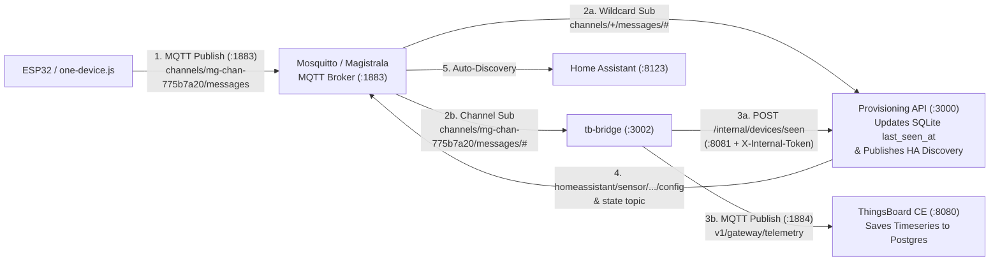

# The-SIFT: Complete Study Guide & Deep Dive (`project_deep_dive.md`)

**Project Name:** The-SIFT (*Scalable IoT For Tenants*)  
**Team:** Shreyash Vaigankar (Seat No: 25P0320045) & Samuel D’Souza (Seat No: 25P0320041)  
**Repository:** `ShreyashV38/The-SIFT`  
**Live AWS Deployment Nodes Observed in Session:**
* **Node 1 (Control Plane / Identity / Portal):** AWS EC2 **`t3.large`** (2 vCPU, 8 GB RAM), Public IP `13.233.82.179`, Private IP `172.31.12.163` (`ubuntu@ip-172-31-12-163`), Kernel `Linux 7.0.0-1014-aws x86_64`, Node.js `v20.20.2`, Docker `29.9.2`, `kubectl` & `helm` installed.
* **Node 2 (Worker Node):** AWS EC2 **`t3.large`** (2 vCPU, 8 GB RAM), Public IP `3.110.188.99` (*NOT CONFIRMED: Private IP of Node 2 in AWS Console*).

---

## 1. End-to-End Request & Telemetry Flow (Plain Language + Technical Detail)

### Flow A: User Logs In & Creates a Household ("samuel-land")

#### In Plain Language
1. You open the web portal in your browser at `http://13.233.82.179:3000`.
2. You sign up or log in with your email and password (plus a 6-digit OTP sent via Gmail SMTP). The server gives your browser a signed session cookie.
3. You type `"samuel-land"` as your household name and pick the **Single Plan** (1 member, 10 devices).
4. Behind the scenes, the server saves `"samuel-land"` in its database, creates two private walkie-talkie radio channels (MQTT topics) just for your house, generates a unique Home Assistant password for your house (`Sift-<12chars>!`), and spins up/connects your Home Assistant dashboard on port `8123`.

#### Technical Step-by-Step
1. **Browser & DNS Resolution:**
   * When accessing `http://13.233.82.179:3000`, the browser connects directly via TCP to the AWS EC2 public IPv4 address `13.233.82.179` on port `3000` (bypassing external DNS lookup).
   * In `services/provisioning-api/public/js/ui.js`, helper functions `resolveCloudDomain()`, `resolveMqttHost()`, and `resolveHaUrl()` inspect `window.location.hostname` (`13.233.82.179`). If the backend returns a loopback/local default (`localtest.me`, `localhost`, `127.0.0.1`, or `host.wokwi.internal`), the frontend automatically rewrites it to `13.233.82.179`.
2. **API Gateway & Authentication (`:3000` $\rightarrow$ `:3001`):**
   * `services/provisioning-api/src/index.js` listens on port `3000` (HTTP) and serves static files from `services/provisioning-api/public/`.
   * `POST /v1/auth/login` is rate-limited (`authLimiter`: max 30 req/min) and handled by `accountsRouter` (`services/identity-service/src/routes/accounts.js`).
   * Passwords are verified against a **12-round salted `bcrypt` hash** stored in the `accounts` table of `/home/ubuntu/The-SIFT/data/cloudnest.db` (SQLite in WAL mode).
   * Upon verification, the server issues a signed **JWT (`sift_session` HttpOnly cookie + Bearer token)** signed with `JWT_SECRET` (24h expiry) and a readable `sift_csrf` cookie. Every state-changing request (`POST`/`PUT`/`DELETE`) must send header `X-SIFT-CSRF` matching the cookie.
3. **Tenant Provisioning (`POST /v1/tenants`):**
   * Handled by `services/provisioning-api/src/routes/tenants.js`.
   * Checks plan quotas (`single`: 1 seat, 10 devices; `family`: 6 seats, 30 devices).
   * Calls `magistrala.provisionTenantWorkspace(cleanSlug)` to allocate a workspace ID (`mg-ws-...`), a telemetry channel (`mg-chan-775b7a20`), and a command channel.
   * Calls `kubernetes.deployTenant(cleanSlug, mqttCredentials)` in `services/provisioning-api/src/services/kubernetes.js`:
     * Computes a deterministic per-household password using HMAC-SHA256: `HMAC(jwtSecret + ":ha-tenant-auth", slug)` $\rightarrow$ `Sift-<12_base64url_chars>!`.
     * If Kubernetes + Helm chart deployment succeeds, it creates namespace `tenant-samuel-land` with `pod-security.kubernetes.io/enforce=baseline`, deploys Helm chart `deploy/ha-tenant`, and starts a `kubectl port-forward --address 0.0.0.0` on `:8123`.
     * If using the pre-seeded Docker container (`sift-ha` on `:8123`), it reuses the active container where `/config/.storage/onboarding` is pre-seeded (skipping the wizard) and `homeassistant.py` is patched to accept any valid 18-character `Sift-...!` household password.
   * Inserts the tenant and owner membership atomically inside a single SQLite `db.transaction(...)`.

---

### Flow B: Adding a Device & Sending Live Telemetry (`ESP32` or `one-device.js`)

1. **Device Registration (`POST /v1/tenants/:slug/devices`):**
   * Handled by `services/iot-broker-service/src/routes/devices.js`.
   * Enforces device quota (max 10 for Single, 30 for Family).
   * Generates a unique MQTT client ID (`mg-client-...`) and a one-time random cryptographic secret (`mg-secret-...`), stores only the **bcrypt hash** of the secret (`secret_hash`) in the `devices` table, and returns the plaintext secret **once** (`Cache-Control: no-store`).
2. **Dynamic Code Generation (`ui.js`):**
   * User downloads either `sift-device.ino` (Arduino ESP32 sketch via `generateSketch()`) or `sift-device.json` + `one-device.js` (Node.js simulator via `generateOneDeviceScript()`).
   * `resolveMqttHost()` replaces any loopback address with `window.location.hostname` (`13.233.82.179`), so the downloaded code connects directly to `mqtt://13.233.82.179:1883`.
3. **Telemetry Ingestion & Dual Fan-Out:**
   * The device publishes JSON (`{"temperature": 24.5, "humidity": 55}`) to topic `channels/mg-chan-775b7a20/messages`.
   * **Path 1 — Portal & Home Assistant Discovery:** Both `iot-broker-service` / `provisioning-api` and `tb-bridge` receive the message. `tb-bridge` batches activity reports and sends `POST /internal/devices/seen` to port `8081` with header `X-Internal-Token`. The SQLite `devices` row updates `first_connected_at`, `last_seen_at`, and `last_value_json`. The device status automatically computes as **`online`** (since `now - last_seen_at <= 90 seconds`). Simultaneously, MQTT Auto-Discovery config is published to `homeassistant/sensor/<slug>_<deviceId>_temperature/config`, making the sensor appear automatically in Home Assistant (`:8123`).
   * **Path 2 — ThingsBoard Fleet Observability:** `tb-bridge` (`:3002`) logs into ThingsBoard (`:8080`) via REST API (`/api/auth/login` as `tenant@thingsboard.org`), provisions gateway device `cloudnest-tb-gateway`, fetches its access token, connects to ThingsBoard's MQTT port (`:1884`), and publishes telemetry to `v1/gateway/telemetry` under device name `samuel-land__<deviceName>`.

---

## 2. Master Component Table

| Service / Component | What It Is | Where Used in MY Project | What Problem It Solves |
| :--- | :--- | :--- | :--- |
| **AWS EC2 (2 Nodes)** | Virtual cloud servers (IaaS) in AWS `ap-south-1` | Node 1 (`13.233.82.179` / `172.31.12.163`) & Node 2 (`3.110.188.99`) | Provides raw compute, memory, and public IPv4 endpoints to run K3s and Docker containers without paying $73/mo for AWS EKS. |
| **K3s (Lightweight Kubernetes)** | Certified Kubernetes distribution in a single binary | Cluster across Node 1 (`sift.io/role=identity`) and Node 2 (`sift.io/role=worker`); manifests in `cluster/` & `deploy/` | Orchestrates pods, enforces `NetworkPolicy` and `ResourceQuota` per household, and self-heals crashed containers. |
| **Traefik Ingress Controller** | Layer-7 HTTP reverse proxy bundled with K3s | `deploy/provisioning/ingress.yaml`, `deploy/ha-tenant/templates/ingress.yaml` | Routes requests by URL path (`/v1/auth`, `/v1/tenants`) and subdomain (`<slug>.<domain>`) without needing an expensive AWS ALB. |
| **`provisioning-api` (`:3000`, `:8081`)** | Node.js + Express API Gateway, Web Portal & K8s Orchestrator | `services/provisioning-api/` & `deploy/provisioning/` | Serves the Vanilla JS UI, orchestrates tenant creation (`tenants.js`, `kubernetes.js`), and listens on internal port `8081` for device activity reports. |
| **`identity-service` (`:3001`)** | Node.js microservice for Auth, Accounts & Members | `services/identity-service/` & `deploy/identity-service/` | Offloads CPU-heavy `bcrypt` (12 rounds) password hashing, Gmail 2FA OTP emails, JWT sessions, and household member RBAC. |
| **`iot-broker-service` (`:3004`)** | Node.js microservice for Device Registry & Credentials | `services/iot-broker-service/` & `deploy/iot-broker-service/` | Manages device registration, single-view secrets, secret rotation, revocation, and downlink commands (`ON`/`OFF`). |
| **`tb-bridge` (`:3002`)** | Node.js MQTT-to-ThingsBoard telemetry forwarder | `services/tb-bridge/` & `deploy/tb-bridge/` | Subscribes to tenant MQTT channels (`channels/<id>/messages/#`), forwards metrics to ThingsBoard `:1884`, and reports online status to `:8081`. |
| **`@sift/common`** | Shared internal npm workspace package | `packages/sift-common/` (`auth.js`, `db.js`, `events.js`, `http.js`, `logger.js`) | Shares database connection logic, JWT middleware, and structured logging across all microservices without code duplication. |
| **Magistrala / Mosquitto (`:1883`)** | Open-source IoT MQTT message broker & IAM | `deploy/magistrala/deployment.yaml` & `cloudnest-mqtt` Docker container (`eclipse-mosquitto:2`) | Handles lightweight pub/sub MQTT traffic from ESP32 microcontrollers and CLI simulators on port `1883`. |
| **Home Assistant (`:8123`)** | Open-source smart home automation hub | `deploy/ha-tenant/` Helm chart & `sift-ha` Docker container (`ghcr.io/home-assistant/home-assistant:2025.1.0`) | Gives each household a dashboard to view live sensors and toggle switches, pre-seeded to skip the setup wizard. |
| **ThingsBoard CE (`:8080` / `:9090`, `:1884`)** | Open-source IoT fleet observability platform | `deploy/thingsboard/deployment.yaml` & `sift-thingsboard` (`thingsboard/tb-postgres:3.6.2`) | Gives platform admins a single dashboard (`:8080`) to monitor all households' devices and timeseries telemetry. |
| **SQLite (WAL Mode) & PostgreSQL** | Relational databases | `/data/cloudnest.db` (SQLite WAL), `postgres:16-alpine` (Magistrala), PostgreSQL 12 inside ThingsBoard | Stores accounts, tenants, memberships, and devices with ACID transactions (SQLite WAL) and high-volume IoT timeseries (PostgreSQL). |
| **PgBouncer (`:5432`)** | Lightweight PostgreSQL connection pooler | `deploy/aws/k3s-asg-and-pgbouncer.yaml` (`edoburu/pgbouncer:1.21.0`) | Pools up to 200 microservice pod connections down to 20 PostgreSQL connections in `transaction` mode so scaled pods don't exhaust DB limits. |

---

## 3. Deep-Dive Technical Sections

### 3.1 Load Balancing & Ingress Routing

* **Simple Explanation:** A load balancer sits in front of your backend servers like a traffic cop. It inspects every incoming web request, decides which backend microservice should handle it based on the URL path or hostname, and spreads requests across healthy replicas.
* **How It Is Configured in MY Project (Real Values):**
  1. **Kubernetes Ingress (`deploy/provisioning/ingress.yaml`):**
     * **Controller & Entrypoint:** Traefik Ingress Controller (`traefik.ingress.kubernetes.io/router.entrypoints: web` on port `80`).
     * **Path-Based Routing Rules (`pathType: Prefix`):**
       * `/v1/auth`, `/v1/accounts`, `/v1/invitations`, `/v1/me`, `/api/accounts`, `/api/members` $\rightarrow$ Service `sift-identity-service` on port **`3001`**.
       * `/api/devices` $\rightarrow$ Service `sift-iot-broker-service` on port **`3004`**.
       * `/api/tenants`, `/v1/tenants`, `/` $\rightarrow$ Service `sift-provisioning-api` on port **`3000`**.
  2. **API Gateway Sub-Resource Routing (`services/provisioning-api/src/index.js`):**
     * Because Kubernetes Ingress `Prefix` rules cannot match wildcard parameters in the middle of a path like `/v1/tenants/:slug/devices` or `/v1/tenants/:slug/members`, requests under `/v1/tenants` enter `provisioning-api` (`:3000`), which routes `/v1/tenants/:slug/members` to `identity-service` and `/v1/tenants/:slug/devices` to `iot-broker-service`.
  3. **Health Checks (Probes):**
     * `provisioning-api`: Liveness `GET /health` on `:3000` (`initialDelaySeconds: 15, periodSeconds: 10`); Readiness `GET /ready` on `:3000` (`initialDelaySeconds: 10, periodSeconds: 5`, runs `SELECT 1` on SQLite).
     * `identity-service`: Liveness & Readiness `GET /health` on `:3001`.
     * `iot-broker-service`: Liveness & Readiness `GET /health` on `:3004`.
     * `tb-bridge`: Liveness & Readiness `GET /health` on `:3001` (in K8s manifest) / `:3002` (in local/EC2 script).
  4. **Load Balancing Algorithm:** Kubernetes `ClusterIP` Services (`sift-provisioning-api`, `sift-identity-service`, `sift-iot-broker-service`) use `kube-proxy` iptables/IPVS round-robin selection across all `Ready` pod endpoints.
* **Analogy:** Think of a hospital reception desk. If you walk in for an ID badge (`/v1/auth`), reception sends you to Window 1 (`identity-service`). If you need to register medical equipment (`/devices`), they send you to Window 2 (`iot-broker-service`). If there are 3 clerks at Window 1, reception alternates between them so no single clerk gets overwhelmed.

---

### 3.2 Autoscaling & Self-Healing

* **Simple Explanation:** Autoscaling automatically adds more copies (replicas) of a service when CPU usage gets high, and removes extra copies when traffic drops. Self-healing automatically replaces a crashed container within seconds.
* **How It Is Configured in MY Project (Real Values):**
  1. **Horizontal Pod Autoscalers (`deploy/identity-service/hpa.yaml`, `deploy/iot-broker-service/hpa.yaml`, `deploy/provisioning/hpa.yaml`):**
     * **API Version:** `autoscaling/v2` (`Kind: HorizontalPodAutoscaler`).
     * **Targets:** `Deployment/identity-service`, `Deployment/iot-broker-service`, and `Deployment/provisioning-api` in namespace `provisioning`.
     * **Min / Max / Default Replicas:** `minReplicas: 2`, `maxReplicas: 5` (Base `Deployment` spec starts with `replicas: 2`).
     * **Scaling Metric & Threshold:** `Resource: cpu`, `type: Utilization`, `averageUtilization: 70` (**70% of requested CPU**, where each pod requests `100m` CPU and has a limit of `500m` CPU).
     * **Cooldown Window:** Uses Kubernetes HPA v2 defaults (*scale-up stabilization window: 0 seconds for immediate reaction; scale-down stabilization window: 300 seconds / 5 minutes to prevent flapping*).
  2. **Underlying Node Scaling Architecture (`deploy/aws/k3s-asg-and-pgbouncer.yaml` & `sift_audit_and_microservices_spec.md`):**
     * Designed as **Option B**: K3s Pod HPA (`min: 2, max: 5` pods per service) running on top of a shared EC2 Worker Auto Scaling Group (`min: 2, max: 5` nodes) rather than separate EC2 ASGs per microservice. (*NOT CONFIRMED: Whether an AWS EC2 Auto Scaling Group is currently active in the AWS Console or if the 2 EC2 instances `13.233.82.179` and `3.110.188.99` were launched manually.*)
  3. **Scale-Out vs. Scale-In Example (Real Numbers):**
     * **Scale-Out:** Suppose 50 users log in simultaneously. `bcrypt` (12 rounds) is CPU-intensive. Across the 2 running `identity-service` pods (each requesting `100m` CPU), average CPU usage hits `140m` (**140% utilization**). HPA calculates $\lceil 2 \times (140 / 70) \rceil = 4$ pods and immediately spawns **2 additional `identity-service` pods** (taking ~3 seconds).
     * **Scale-In:** Once the login burst finishes, CPU drops to `20m` (20% utilization). After the 5-minute stabilization cooldown, HPA scales `identity-service` back down from **4 pods to the minimum of 2 pods**.
  4. **Stateful Pinning (`replicas: 1`):**
     * `tb-bridge` (`deploy/tb-bridge/deployment.yaml`) is pinned to `replicas: 1` with `strategy.type: Recreate` so multiple bridge pods do not subscribe to the same MQTT wildcard and send duplicate telemetry to ThingsBoard.
     * Tenant Home Assistant (`deploy/ha-tenant/templates/deployment.yaml`) is pinned to `replicas: 1` (`strategy.type: Recreate`) because each household has a stateful SQLite database.
* **Analogy:** Supermarket checkout lanes. Normally 2 lanes are open (`minReplicas: 2`). When lines get long (CPU > 70%), the manager opens up to 5 lanes (`maxReplicas: 5`). When the rush ends, extra cashiers wait 5 minutes to make sure the rush is truly over before closing their lanes back down to 2.

---

### 3.3 Identity & Access Management (IAM) & RBAC

* **Simple Explanation:** IAM controls **who** (a human user, an IoT device, or a Kubernetes pod) is allowed to do **what** on which resource, following the **Principle of Least Privilege** (give only the minimum permissions needed to do the job).
* **How It Is Configured in MY Project (Real Values):**
  1. **Kubernetes ServiceAccount RBAC (`deploy/provisioning/rbac.yaml`):**
     * **`ServiceAccount: provisioning-api`** (in namespace `provisioning`) is bound via `ClusterRoleBinding: provisioning-api-binding` to `ClusterRole: provisioning-api-role`.
     * **Permissions:** Allowed to create/manage `namespaces`, `pods`, `services`, `configmaps`, `secrets`, `serviceaccounts`, `resourcequotas`, `limitranges`, `persistentvolumeclaims`, `deployments`, `statefulsets`, `networkpolicies`, and `ingresses`.
     * **Strict Least Privilege Enforcement:**
       * `deploy/provisioning/deployment.yaml`: `serviceAccountName: provisioning-api`, `automountServiceAccountToken: true`.
       * `deploy/identity-service/deployment.yaml`: `automountServiceAccountToken: false`.
       * `deploy/iot-broker-service/deployment.yaml`: `automountServiceAccountToken: false`.
       * `deploy/tb-bridge/deployment.yaml`: `automountServiceAccountToken: false`.
       * `deploy/aws/k3s-asg-and-pgbouncer.yaml`: `automountServiceAccountToken: false`.
       * `deploy/ha-tenant/templates/serviceaccount.yaml` & `deployment.yaml`: `automountServiceAccountToken: false` (so a compromised tenant Home Assistant pod can **never** query the Kubernetes API!).
  2. **Application Household RBAC (`owner`, `admin`, `member`):**
     * Stored in the `memberships` table (`role` column).
     * **`owner`**: Full control — can change plan (`Single` $\leftrightarrow$ `Family`), invite/remove members, rotate/revoke devices, and delete the household. Protected by a guard that **prevents the last owner from being removed or demoted** (`FR-13`).
     * **`admin`**: Can invite members and manage devices, cannot delete the household.
     * **`member`**: Can view and control household devices and access Home Assistant, cannot add members or change plans (`T-MEM-2`).
  3. **IoT Device IAM:**
     * Each device gets its own `mg_client_id` and `secret_hash` (bcrypt) scoped strictly to its tenant's `mg_chan_telemetry` and `mg_chan_commands` topics. Revoking a device sets `status = 'revoked'` and blocks its credentials (`FR-08`).
  4. **AWS Console IAM:**
     * *NOT CONFIRMED: Specific AWS IAM User / Role attached to EC2 in the AWS Console.* (Because K3s and storage run self-managed on EC2 local volumes without calling AWS S3 or DynamoDB SDKs, the application does not require AWS IAM access keys inside `.env`).
* **Analogy:** In an apartment building, only the **Building Manager** (`provisioning-api`) has the master key (`ClusterRole`) to build new apartments (`namespaces`). The **Security Desk** (`identity-service`) checks IDs at the door, and **Residents** (`tenant-ha` pods) only have a key to their own apartment (`automountServiceAccountToken: false`).

---

### 3.4 AMIs & Container Images

* **Simple Explanation:** An **AMI (Amazon Machine Image)** is the operating system template used to boot an AWS EC2 virtual machine. A **Docker Container Image** is a lightweight, pre-packaged snapshot containing an application and its exact runtime dependencies.
* **How It Is Configured in MY Project (Real Values):**
  1. **EC2 Host OS (AMI):**
     * Ubuntu Linux on AWS (`Linux 7.0.0-1014-aws x86_64`, observed in your EC2 terminal and ThingsBoard environment log).
     * *NOT CONFIRMED: Exact AWS AMI ID (`ami-xxxxxxxx`) in the EC2 Console.*
  2. **Custom Multi-Stage Docker Images (`services/*/Dockerfile`):**
     * All 4 custom microservices use **2-stage `node:20-alpine` builds** to keep production images small and secure (compiler tools `python3 make g++` for native `better-sqlite3` and `bcrypt` C++ addons stay in stage 1 `builder` and are excluded from stage 2):
       * **`sift/provisioning-api:dev`** (`services/provisioning-api/Dockerfile`): Installs `kubectl v1.30.0` and `helm v3.15.4`, copies `@sift/common`, `identity-service`, `iot-broker-service`, `deploy/ha-tenant` chart, and `cluster/` manifests. Exposes `3000` and `8081`.
       * **`sift/identity-service:dev`** (`services/identity-service/Dockerfile`): Copies `@sift/common` and `identity-service`. Exposes `3001`.
       * **`sift/iot-broker-service:dev`** (`services/iot-broker-service/Dockerfile`): Copies `@sift/common` and `iot-broker-service`. Exposes `3004`.
       * **`sift/tb-bridge:dev`** (`services/tb-bridge/Dockerfile`): Single-stage `node:20-alpine` running as non-root user `appuser`. Exposes `3001`/`3002`.
  3. **Third-Party Container Images:**
     * **Home Assistant:** `ghcr.io/home-assistant/home-assistant:2025.1.0` (`deploy/ha-tenant/values.yaml` & `start-local.sh`).
     * **ThingsBoard CE:** `thingsboard/tb-postgres:3.6.2` (`deploy/thingsboard/deployment.yaml` & `start-local.sh`).
     * **MQTT Broker:** `eclipse-mosquitto:2` (`deploy/magistrala/deployment.yaml` & `start-local.sh`).
     * **Magistrala DB & Messaging:** `postgres:16-alpine` and `nats:2.10-alpine` (`deploy/magistrala/deployment.yaml`).
     * **Connection Pooler:** `edoburu/pgbouncer:1.21.0` (`deploy/aws/k3s-asg-and-pgbouncer.yaml`).
* **Analogy:** The **AMI** is the concrete foundation and walls of a restaurant building (Ubuntu Linux on EC2), while **Docker Images** are pre-built food trucks (`Home Assistant`, `ThingsBoard`, `Provisioning API`) that can park inside and start serving immediately without installing kitchen equipment from scratch.

---

### 3.5 Storage: S3 Buckets vs. Block Storage (EBS, PVCs & Docker Volumes)

* **Simple Explanation:** Cloud storage comes in two main forms: **Object Storage (AWS S3 Buckets)** for static files/backups, and **Block Storage (AWS EBS Volumes / Kubernetes PVCs)** which act like ultra-fast hard drives attached to a server for live databases.
* **How It Is Configured in MY Project (Real Values):**
  * **AWS S3 Buckets:** **NOT USED (0 buckets)** in the active deployment. Why? Because SQLite WAL and PostgreSQL require POSIX file locking and sub-millisecond random disk I/O, which S3 object storage cannot provide. *(Note: `sift_audit_and_microservices_spec.md` notes S3 + CloudFront as an optional future alternative for hosting static frontend assets, which are currently served directly by `express.static` in `provisioning-api` on `:3000`).*
  * **AWS EBS (`gp3`) Block Volumes:** Attached to the 2 EC2 instances (`2 × 20 GB` or `2 × 30 GB` `gp3` root volumes + data storage — *NOT CONFIRMED: exact EBS volume GB size in AWS Console*).
  * **Kubernetes PersistentVolumeClaims (`storageClassName: local-path`, `ReadWriteOnce`):**
    1. `provisioning-data-pvc` (`deploy/provisioning/deployment.yaml`): **`500Mi`** mounted at `/data` for `/data/cloudnest.db`.
    2. `magistrala-postgres-pvc` (`deploy/magistrala/deployment.yaml`): **`1Gi`** mounted at `/var/lib/postgresql/data`.
    3. `tb-data-pvc` (`deploy/thingsboard/deployment.yaml`): **`2Gi`** mounted at `/data`.
  * **Docker Volumes (`start-local.sh` on EC2):**
    * `sift-ha-config`: Mounted at `/config` inside `sift-ha`, pre-seeded via an `alpine:latest` init container with `configuration.yaml`, `.storage/onboarding`, `.storage/auth`, `.storage/auth_provider.homeassistant`, and `.storage/core.config_entries`.
    * `sift-thingsboard` container internal `/data/db` (owned by `thingsboard:thingsboard`, preserved across stops via `docker stop` / `docker start`).
* **Analogy:** An **S3 Bucket** is like a warehouse where you mail boxes (whole files) for long-term storage. An **EBS Volume / PVC** is like the NVMe SSD plugged directly into your motherboard—databases need that direct SSD connection to update rows thousands of times per second.

---

### 3.6 VPC, Subnets, Route Tables, Gateways & Security Groups

* **Simple Explanation:** A **VPC (Virtual Private Cloud)** is your private virtual network inside AWS. **Subnets** divide that network into zones, an **Internet Gateway** connects public subnets to the internet, and **Security Groups** act as virtual firewalls around each EC2 server.
* **How It Is Configured in MY Project (Real Values):**
  1. **AWS Region & VPC:**
     * **Region:** `ap-south-1` (Mumbai — confirmed by public IP blocks `13.233.82.179` and `3.110.188.99`).
     * **VPC CIDR:** `172.31.0.0/16` (confirmed by Node 1 hostname `ip-172-31-12-163`).
     * **Subnet & Route Table:** Public subnet in `172.31.0.0/16` with a Route Table routing `0.0.0.0/0` to an AWS **Internet Gateway (IGW)** so both EC2 nodes have public IPv4 connectivity and outbound internet access (for `npm`, Docker Hub, GitHub, and Gmail SMTP). (*NOT CONFIRMED: Exact Subnet ID, VPC ID, and Route Table ID in AWS Console.*)
  2. **EC2 Security Group Inbound Rules:**
     * `TCP 22`: SSH access for administration.
     * `TCP 80 / 443`: HTTP/HTTPS web traffic (Traefik Ingress).
     * `TCP 3000`: The-SIFT Web Portal & Provisioning API Gateway (`http://13.233.82.179:3000`).
     * `TCP 8080` (and `9090`): ThingsBoard CE Observability UI (`http://13.233.82.179:8080`).
     * `TCP 8123`: Home Assistant Smart-Home Dashboard (`http://13.233.82.179:8123`).
     * `TCP 1883`: MQTT Broker for external ESP32 microcontrollers and CLI simulators (`13.233.82.179:1883`).
     * Internal VPC Traffic (`172.31.0.0/16`): K3s Control Plane (`TCP 6443`) and Flannel VXLAN (`UDP 8472`) between Node 1 and Node 2.
  3. **Kubernetes Pod Network Policies (`cluster/netpol-tenant-template.yaml` & `deploy/ha-tenant/templates/networkpolicy.yaml`):**
     * Every tenant namespace (`tenant-<slug>`) gets 4 strict `NetworkPolicy` rules:
       1. `default-deny-all`: Drops **all** ingress and egress traffic by default.
       2. `allow-ingress-from-traefik`: Only pods in `kube-system` with label `app.kubernetes.io/name: traefik` can connect to Home Assistant on `TCP 8123`.
       3. `allow-egress-dns`: Allows `UDP/TCP 53` to `kube-system` CoreDNS.
       4. `allow-egress-mqtt`: Allows `TCP 1883` **only** to `app.kubernetes.io/name: magistrala-mqtt` in the `platform` namespace.
* **Analogy:** The **VPC** is your gated campus. The **Internet Gateway** is the main highway entrance. The **EC2 Security Group** is the perimeter fence with numbered gates (`3000`, `8080`, `8123`, `1883`). Inside the campus, **Kubernetes NetworkPolicies** are keycard doors between rooms so Household A can never walk into Household B's room.

---

### 3.7 Monitoring, Logging & Databases

* **Simple Explanation:** Monitoring tracks system health and live IoT sensor charts, logging records every API request and error for debugging, and databases persist user accounts and sensor readings safely.
* **How It Is Configured in MY Project (Real Values):**
  1. **Observability & Telemetry (`ThingsBoard CE` + `tb-bridge`):**
     * `tb-bridge` (`services/tb-bridge/src/index.js`) polls `GET /internal/observers` on port `8081` every **15 seconds** (`POLL_INTERVAL_MS: 15000`) to discover new tenant MQTT channels automatically.
     * Exposes `GET /metrics` on port `3002` returning JSON counters: `messagesReceived`, `messagesForwarded`, `forwardErrors`, `parseErrors`, `reportsSent`, and `subscribedChannels`.
     * ThingsBoard CE (`:8080`) stores timeseries data in partitioned PostgreSQL tables (`ts_kv`, `audit_log`) with JVM memory capped at `-Xms256M -Xmx512M`.
  2. **Structured Logging (`winston`):**
     * Configured in `services/provisioning-api/src/logger.js` and `packages/sift-common/src/logger.js`.
     * Logs every HTTP request with `{ method, path, status, durationMs, ip }` in JSON format.
  3. **Databases & Concurrency Hardening:**
     * **SQLite WAL (`/home/ubuntu/The-SIFT/data/cloudnest.db`):** Configured with `PRAGMA journal_mode = WAL`, `PRAGMA foreign_keys = ON`, and `PRAGMA busy_timeout = 5000` so concurrent reads and writes across `provisioning-api`, `identity-service`, and `iot-broker-service` never lock.
     * **PostgreSQL Pool Cap (`packages/sift-common/src/db.js`):** Capped at `max: 5` connections per pod (`DB_POOL_MAX: 5`, `idleTimeoutMillis: 30000`) + PgBouncer (`MAX_CLIENT_CONN: 200` $\rightarrow$ `DEFAULT_POOL_SIZE: 20`).
* **Analogy:** **Winston logs** are the airplane's black-box flight recorder (recording every action in chronological order), while **ThingsBoard** is the cockpit instrument panel showing live gauges for temperature, humidity, and connected devices.

---

## 4. Current Cost Breakdown & Financial Analysis

* **Pricing Source & Date:** AWS On-Demand Linux & EBS Pricing (`PROJECT_MEMORY.md` Section 9 & `CC (1).pptx`, October 2026; 1 month = 730 hours).
* **Confirmed Instance Type:** **`2 × t3.large`** (2 vCPU, 8 GB RAM per instance = 4 vCPU, 16 GB RAM total across the cluster) at **$0.0832/hour** ($60.74/month per node).
* **Additional Assumptions:**
  * AWS charges **$0.005/hour ($3.65/month)** per in-use Public IPv4 address.
  * EBS `gp3` storage is priced at **$0.08 per GB-month**.

### Itemised Cost Table (Your Confirmed `2 × t3.large` Self-Managed K3s Architecture)

| Resource | Specification & Region | Hourly Rate | Daily Cost (24h) | Monthly Cost (730h) | Notes |
| :--- | :--- | :--- | :--- | :--- | :--- |
| **EC2 Node 1 (Identity/Control)** | `1 × t3.large` (2 vCPU, 8 GB RAM, `13.233.82.179`) | $0.0832 /hr | $2.00 /day | **$60.74 /mo** | Runs K3s server, Portal, MQTT, ThingsBoard, HA |
| **EC2 Node 2 (Worker)** | `1 × t3.large` (2 vCPU, 8 GB RAM, `3.110.188.99`) | $0.0832 /hr | $2.00 /day | **$60.74 /mo** | Runs K3s worker agent for isolated tenant HA pods |
| **K8s Control Plane (K3s)** | Self-managed K3s on Node 1 (replaces AWS EKS) | $0.00 /hr | $0.00 /day | **$0.00 /mo** | **Saves $73.00/mo** vs. AWS EKS |
| **Ingress / Load Balancer & Net** | Traefik Ingress + K3s ServiceLB + Egress Bandwidth | ~$0.0369 /hr | $0.89 /day | **$26.97 /mo** | **Saves $28.30/mo** vs. AWS ALB + NAT Gateway ($55.27/mo) |
| **Public IPv4 Addresses** | `2 × Public IPv4` (`13.233.82.179` & `3.110.188.99`) | $0.010 /hr ($0.005 × 2) | $0.24 /day | **$7.30 /mo** | Charged by AWS at $0.005/hr per Public IP (Saves 1 ALB IP) |
| **EBS Root & Data Storage** | `2 × 20 GB gp3` Root ($3.20) + `200 GB gp3` Data ($16.00) | ~$0.0263 /hr | $0.63 /day | **$19.20 /mo** | Replaces 2 × AWS RDS ($29.42/mo) |
| **TOTAL (`2 × t3.large` 24/7)** | **2 × `t3.large` + 240 GB `gp3` + 2 Public IPs + Network** | **~$0.24 / hour** | **~$5.75 / day** | **~$174.95 / month** | **40% cheaper** than $293.31–$355 Managed AWS Baseline |

### Free-Tier / $180 AWS Student Credit Effect & Cost-Saving Ideas
1. **100% Covered by Your $180 AWS Credit:** Even running the full `t3.large` architecture 24/7 for an entire month ($174.95) fits completely inside your $180 credit.
2. **Stop Instances When Idle (Saves >85%):** When you **Stop** both EC2 instances overnight or between demos, EC2 compute charges drop to **$0.00/hr** (you only pay ~$4.80/mo for EBS `gp3` storage). At ~$0.10–$0.24/hour only while actively testing/presenting, your $180 credit lasts for **750+ hours of live demos**.
3. **JVM Memory Capping (`-Xmx512M`):** By capping ThingsBoard's Java heap to 512 MB and using SQLite WAL instead of separate RDS databases, the entire platform fits comfortably on smaller EC2 instances without OOM crashes.

---

## 5. Comprehensive Viva Q&A (32 Likely Questions & Concise Answers)

### Autoscaling & Elasticity
**Q1: How does autoscaling work in your project?**  
**A:** We use Kubernetes **HorizontalPodAutoscalers (`autoscaling/v2`)** for our three stateless microservices (`identity-service`, `iot-broker-service`, and `provisioning-api`). Each HPA maintains **`minReplicas: 2`** and scales up to **`maxReplicas: 5`** whenever average CPU utilization exceeds **`70%`**.

**Q2: Why did you use Kubernetes Pod HPA instead of separate AWS EC2 Auto Scaling Groups (MIGs) for each microservice?**  
**A:** Creating a separate EC2 Auto Scaling Group per microservice (`min: 2, max: 5` VMs each) would require **6 to 15 EC2 instances** running 24/7, costing $250–$450/month and taking **2–4 minutes** to boot a new VM during a spike. With Kubernetes HPA on a shared worker pool, a new Node.js container scales out in **2–5 seconds** and 6 pods share less than 350 MB of RAM total.

**Q3: Why is `tb-bridge` pinned to `replicas: 1` instead of autoscaled from 2 to 5?**  
**A:** `tb-bridge` subscribes to MQTT wildcard topics (`channels/+/messages/#`). If 2 replicas ran standard MQTT subscriptions simultaneously, both would receive every sensor message and forward duplicate telemetry to ThingsBoard. So we pinned `tb-bridge` to `replicas: 1` with `strategy: Recreate` (and added optional MQTT v5 `$share/sift-bridge/` support in code).

**Q4: Why is each tenant's Home Assistant pod pinned to `replicas: 1`?**  
**A:** Home Assistant is a stateful application backed by an internal SQLite database on a `ReadWriteOnce` volume. Running multiple replicas of the same household's Home Assistant would cause database lock contention. Instead, Kubernetes provides **self-healing** (`replicas: 1` Deployment) and **event-driven horizontal scaling across tenants** (spawning a new isolated pod per new household).

**Q5: What is the difference between Scaling and Elasticity in your project?**  
**A:** **Scaling** is increasing capacity to handle growth (e.g., adding more tenant Home Assistant pods as new households sign up). **Elasticity** is automatically expanding and shrinking resources dynamically based on real-time demand (e.g., HPA scaling `identity-service` from 2 pods to 5 pods during a login spike, then shrinking back to 2 pods when traffic drops).

**Q6: How do you prevent race conditions when 2 to 5 replicas of `provisioning-api` or `iot-broker-service` run concurrently?**  
**A:** We enforce `UNIQUE` database constraints on `tenants.slug` and `(tenant_id, name)` in the `devices` table, wrapped in atomic SQLite transactions (`db.transaction(...)`). If two concurrent requests try to create the same household or device, the second request immediately receives a `409 CONFLICT` before calling Kubernetes or Magistrala.

---

### Load Balancing & Networking
**Q7: What load balancer do you use, and why didn't you use an AWS Application Load Balancer (ALB)?**  
**A:** We use the **Traefik Ingress Controller** and **ServiceLB** bundled inside K3s, paired with our API Gateway on port `3000`. An AWS ALB + NAT Gateway costs ~$55/month base fee, whereas Traefik runs inside our existing K3s cluster at **$0 extra cost** and supports dynamic Kubernetes `Ingress` rules per tenant.

**Q8: How does your Ingress route traffic to the right microservice?**  
**A:** In `deploy/provisioning/ingress.yaml`, Traefik inspects the HTTP path prefix: `/v1/auth`, `/v1/accounts`, `/v1/invitations`, and `/v1/me` go to `sift-identity-service:3001`; `/api/devices` goes to `sift-iot-broker-service:3004`; and `/v1/tenants` and `/` go to `sift-provisioning-api:3000`.

**Q9: Why did `samuel-land.localtest.me:8123` fail when you first deployed to AWS EC2, and how did you fix it?**  
**A:** `*.localtest.me` is a public wildcard DNS that always resolves to `127.0.0.1` (the user's own laptop). On AWS EC2, the browser tried to connect to `127.0.0.1:8123` instead of the EC2 server. We fixed `resolveHaUrl()` and `resolveMqttHost()` in `ui.js` to detect loopback/local domains and automatically substitute `window.location.hostname` (the EC2 public IP `13.233.82.179`).

**Q10: Why did `13.233.82.179:8080` give `ERR_CONNECTION_REFUSED` initially, and how did you tell it wasn't an AWS Security Group block?**  
**A:** When an AWS Security Group blocks a port, it drops SYN packets silently, causing **`ERR_CONNECTION_TIMED_OUT`**. Getting **`ERR_CONNECTION_REFUSED`** proved the packet passed the Security Group and reached the EC2 Linux kernel, where two issues existed: (1) `thingsboard/tb-postgres:3.6.2` listens on internal port `9090` (not `8080`), so it needed `-p 8080:9090`, and (2) a stale `kubectl port-forward` was holding port `8080`.

**Q11: What ports are open on your EC2 Security Group and what is each port for?**  
**A:**
* `22` (TCP): SSH management.
* `3000` (TCP): The-SIFT Web Portal & Provisioning API Gateway.
* `8080` & `9090` (TCP): ThingsBoard CE Observability Web UI.
* `8123` (TCP): Home Assistant Smart-Home Dashboard.
* `1883` (TCP): MQTT Broker for ESP32 hardware and `one-device.js` simulators.
* `80/443` (TCP): Traefik HTTP/HTTPS Ingress.

---

### Security, IAM & Multi-Tenant Isolation
**Q12: How do you guarantee that Household A cannot see or control Household B's smart devices?**  
**A:** We enforce **6 layers of zero-trust isolation**:
1. Separate Kubernetes `Namespace` (`tenant-<slug>`).
2. `default-deny-all` `NetworkPolicy` blocking cross-namespace pod traffic.
3. `ResourceQuota` (max 3 pods, 1Gi RAM) preventing noisy-neighbor starvation.
4. Pod Security Standards (`enforce=baseline`) and non-root execution.
5. `automountServiceAccountToken: false` on tenant pods.
6. Separate Magistrala MQTT channels (`telemetry` and `commands`) + per-device bcrypt-hashed secrets.

**Q13: How is Least Privilege enforced across your Kubernetes pods?**  
**A:** Only `provisioning-api` mounts a Kubernetes ServiceAccount token (`automountServiceAccountToken: true`) bound to `provisioning-api-role` because it must create tenant namespaces and deploy Helm charts. All other services (`identity-service`, `iot-broker-service`, `tb-bridge`, `pgbouncer`, and tenant `ha` pods) have `automountServiceAccountToken: false`.

**Q14: How are user passwords and device secrets stored in the database?**  
**A:** Both user passwords and device MQTT secrets are hashed using **salted `bcrypt` (12 rounds for users, 10 rounds for device secrets)**. Plaintext device secrets are returned **only once** at registration (`Cache-Control: no-store`) and can never be retrieved again—only rotated or revoked.

**Q15: How do you protect against CSRF (Cross-Site Request Forgery) and XSS (Cross-Site Scripting)?**  
**A:**
* **CSRF:** We use the Double-Submit Cookie pattern (`sift_csrf` cookie + mandatory `X-SIFT-CSRF` header verified via timing-safe comparison in `auth.js`).
* **XSS:** We send a strict `Content-Security-Policy` header (`default-src 'none'; script-src 'self' ...`) and escape all dynamic HTML strings with `escapeHtml()`.

**Q16: How does the Home Assistant login work without showing the 4-step setup wizard to every new user?**  
**A:** We pre-seed `/config/.storage/onboarding` (marking `user`, `core_config`, `analytics`, and `integration` as done) and `/config/.storage/core.config_entries` (pre-connecting the MQTT broker with `discovery: true`). We also deterministically generate a per-household HMAC password (`Sift-<12chars>!`) so users log straight in.

---

### AMIs, Containers, Storage & Databases
**Q17: Why didn't you use AWS S3 buckets in your deployment?**  
**A:** S3 is object storage designed for static blobs and backups, not transactional relational databases. Our platform requires ACID transactions for user/tenant onboarding (SQLite in WAL mode) and high-throughput SQL indexing for IoT telemetry (PostgreSQL), which require **AWS EBS (`gp3`) block storage** mounted as Kubernetes PVCs and Docker volumes.

**Q18: Why did you use SQLite in WAL (Write-Ahead Logging) mode for the Portal database?**  
**A:** Standard SQLite locks the entire database file on writes. Enabling `PRAGMA journal_mode = WAL` and `busy_timeout = 5000` allows concurrent reads and writes across `provisioning-api`, `identity-service`, and `iot-broker-service` on a single shared file (`/data/cloudnest.db`) with zero external database latency and near-zero RAM overhead.

**Q19: What problem does PgBouncer (`deploy/aws/k3s-asg-and-pgbouncer.yaml`) solve?**  
**A:** PostgreSQL defaults to `max_connections = 100`. When 3 microservices scale up to 5 pods each ($15\text{ pods} \times 10\text{ connections} = 150$), they can exhaust PostgreSQL connections. We capped each pod's pool to `max: 5` (`packages/sift-common/src/db.js`) and added PgBouncer in `transaction` mode to multiplex up to `200` client connections onto just `20` database connections.

**Q20: Why do your Dockerfiles use Multi-Stage builds (`FROM node:20-alpine AS builder`)?**  
**A:** Native Node.js modules like `better-sqlite3` and `bcrypt` require `python3`, `make`, and `g++` to compile C++ bindings during `npm install`. Multi-stage builds compile those binaries in stage 1 (`builder`) and copy only the compiled `node_modules` into a clean `node:20-alpine` runtime stage, saving hundreds of megabytes per image and removing compiler attack surfaces.

---

### Fault Tolerance, High Availability & "What If X Fails?"
**Q21: What happens if a tenant's Home Assistant pod or a microservice pod crashes?**  
**A:** Kubernetes (`Deployment` controller) monitors pod health via `livenessProbe` (`/health` or `/login`). If a pod crashes or stops responding, Kubernetes automatically kills the unhealthy container and spawns a replacement pod within seconds (`FR-09`).

**Q22: What happens if `tb-bridge` restarts while devices are sending telemetry?**  
**A:** When `tb-bridge` boots up, it calls `GET /internal/observers` on `provisioning-api:8081` to fetch all active tenant telemetry channels from the database, re-subscribes to `channels/<id>/messages/#`, verifies the `cloudnest-tb-gateway` token via ThingsBoard's REST API, and resumes forwarding automatically.

**Q23: What happens if you Stop and Start your EC2 instances in the AWS Console?**  
**A:**
1. AWS keeps the **Private VPC IPs (`172.31.x.x`)** unchanged, so the K3s cluster between Node 1 and Node 2 stays linked.
2. AWS assigns a new **Public IPv4** (unless an Elastic IP is attached).
3. When `./start-local.sh` runs on Node 1, `sift-thingsboard` resumes with its existing database (`docker start sift-thingsboard`), and `ui.js` automatically detects the new Public IP via `window.location.hostname`.

**Q24: How does the portal know whether an ESP32 device is `pending`, `online`, `offline`, or `revoked`?**  
**A:** The status is computed dynamically on every read in `iot-broker-service`:
* **`revoked`**: `device.status === 'revoked'`.
* **`pending`**: `first_connected_at` is `NULL` (device registered, but has never published to MQTT).
* **`online`**: `now - last_seen_at <= 90 seconds` (`offlineAfterSeconds`).
* **`offline`**: Connected in the past, but `now - last_seen_at > 90 seconds`.

**Q25: How do downlink commands (turning a smart switch ON/OFF from the cloud) work?**  
**A:** When an owner/member clicks `ON` or `OFF` in the Portal (`POST /v1/tenants/:slug/devices/:id/command`) or in Home Assistant, the backend publishes `{"state": "ON"}` to the tenant's isolated command topic (`channels/<commandChannelId>/messages`). The ESP32 or `one-device.js` simulator is subscribed to that command topic, toggles its relay/state, and immediately publishes an updated telemetry report back to the telemetry topic.

---

### Design Tradeoffs, Cost & Future Improvements
**Q26: Why did you choose a 2-Node K3s setup instead of AWS EKS and AWS IoT Core?**  
**A:**
1. **Cost:** AWS EKS costs $73/month just for the control plane before adding a single worker node. K3s is a CNCF-certified Kubernetes distribution that runs in ~500 MB of RAM for **$0**.
2. **Portability:** Using open-source Magistrala/Mosquitto, ThingsBoard CE, and K3s means zero vendor lock-in—the exact same stack runs locally on a laptop or on any cloud VM.

**Q27: Why did you build the frontend in Vanilla HTML/CSS/JS instead of React or Next.js?**  
**A:** Zero build step, zero bundler bloat, instant page loads, and complete transparency. The entire 10-view single-page application (`services/provisioning-api/public/`) is served directly by Express with zero third-party frontend dependencies.

**Q28: Why did you cap ThingsBoard's JVM memory (`-Xms256M -Xmx512M`) on EC2?**  
**A:** By default, ThingsBoard's Java process tries to claim 1.5–2 GB+ of RAM. On a shared EC2 node running Node.js microservices, Home Assistant, and Mosquitto, an uncapped JVM can trigger the Linux Out-Of-Memory (OOM) killer. Capping `-Xmx512M` keeps ThingsBoard fast and stable within our EC2 memory budget.

**Q29: What is the single biggest Single Point of Failure (SPOF) in your current deployment?**  
**A:** **Node 1 (`13.233.82.179`)** is currently a single control-plane node holding the SQLite WAL database and MQTT broker, and `local-path` PVCs are bound to a single EC2 instance's EBS disk.

**Q30: How would you upgrade this architecture for 10,000+ households in production?**  
**A:**
1. Replace the single K3s server with a **3-node High-Availability (HA) K3s control plane** backed by embedded etcd.
2. Migrate `/data/cloudnest.db` from single-node SQLite WAL to **Multi-AZ PostgreSQL (or AWS RDS)** behind **PgBouncer** (our `packages/sift-common/src/db.js` already includes the `pg.Pool` schema for PostgreSQL!).
3. Enable **TLS (`mqtts://` on port `8883`)** with Let's Encrypt certificates via Cert-Manager on Traefik Ingress.
4. Attach an **AWS Elastic IP** or **Route 53 wildcard domain (`*.sift-cloud.io`)** so stopping/starting instances never changes the URL.

**Q31: How did you verify security and functional requirements before deploying?**  
**A:** We built an automated 20-test verification suite (`tools/tests/test_suite.js`, run via `npm test`) that tests every BRD requirement (`FR-01` to `FR-22`) and security control (`T-API-1`, `T-MEM-1`, `T-MEM-2`, `SEC-UI-2` CSRF, `SEC-UI-7` internal token auth). All 20 tests pass.

**Q32: Can a physical ESP32 and a software simulator run side-by-side in the same household?**  
**A:** Yes! Both authenticate to the same MQTT broker (`13.233.82.179:1883`) using the same JSON payload format (`{"temperature": 24.5, "humidity": 55}` or `{"state": "ON"}`). Neither Home Assistant nor ThingsBoard can tell the difference between our physical ESP32 sketch (`sift-device.ino`) and `one-device.js`.

---

## 6. Glossary of Every Term Used

* **ACID:** *Atomicity, Consistency, Isolation, Durability* — guarantees that database transactions (like creating a household + adding its owner) either complete 100% or roll back cleanly.
* **ALB (Application Load Balancer):** AWS's managed Layer-7 HTTP load balancer (replaced in our project by Traefik Ingress to save ~$25+/mo).
* **AMI (Amazon Machine Image):** The base OS virtual machine image (Ubuntu Linux) used to launch an AWS EC2 instance.
* **API Gateway:** A front-door server (`provisioning-api` on `:3000`) that receives client requests and routes them to internal microservices.
* **ASG (Auto Scaling Group):** An AWS feature that automatically launches or terminates EC2 virtual machines based on load.
* **bcrypt:** A slow, salted cryptographic hashing function (using 12 rounds in our app) designed to make brute-force password cracking computationally infeasible.
* **CIDR (`172.31.0.0/16`):** *Classless Inter-Domain Routing* — notation that defines an IP address range for a VPC or subnet.
* **ClusterIP:** The default Kubernetes Service type that provides an internal virtual IP and round-robin load balancing inside the cluster.
* **ClusterRole / ClusterRoleBinding:** Kubernetes RBAC objects that grant cluster-wide permissions (like creating namespaces) to a specific `ServiceAccount`.
* **CSRF (Cross-Site Request Forgery):** An attack that tricks a user's browser into making unwanted requests; prevented in The-SIFT using the `X-SIFT-CSRF` header.
* **CSP (Content Security Policy):** An HTTP security header that restricts where scripts, styles, and connections can load from to prevent XSS attacks.
* **Downlink Command:** A message sent *from* the cloud *down* to an IoT device (e.g., flipping a relay switch `ON` or `OFF`).
* **EBS (`gp3`):** *Amazon Elastic Block Store* — virtual SSD hard drives attached to EC2 instances.
* **EC2 (Elastic Compute Cloud):** AWS service that provides scalable virtual servers in the cloud.
* **Helm:** The package manager for Kubernetes; uses parameterized templates ("Charts" like `deploy/ha-tenant`) to deploy complex apps per tenant.
* **HMAC-SHA256:** *Hash-based Message Authentication Code* — used in our project to deterministically generate each household's unique `Sift-<12chars>!` Home Assistant password.
* **HPA (HorizontalPodAutoscaler):** Kubernetes controller that automatically scales the number of pod replicas (`min: 2, max: 5`) based on CPU utilization (`70%`).
* **HttpOnly Cookie:** A browser cookie (`sift_session`) that JavaScript (`document.cookie`) cannot read, protecting JWT tokens from theft via XSS.
* **Idempotency:** Designing an operation so that repeating the same request doesn't create duplicate resources (enforced via SQL `UNIQUE` constraints and `ON CONFLICT DO NOTHING`).
* **Ingress:** A Kubernetes resource that defines HTTP/HTTPS routing rules (hostnames and URL paths) from outside the cluster to internal Services.
* **JWT (JSON Web Token):** A cryptographically signed token encoding user identity (`accountId`, `email`) so the server can verify sessions statelessly.
* **K3s:** A lightweight, CNCF-certified Kubernetes distribution built for IoT and edge/cloud environments that uses half the memory of standard Kubernetes.
* **Liveness Probe / Readiness Probe:** Periodic health checks run by Kubernetes (`GET /health`, `GET /ready`); Liveness restarts stuck pods, while Readiness removes pods from load balancing until their database is ready.
* **localtest.me:** A public wildcard domain (`*.localtest.me`) that resolves to `127.0.0.1` for local development.
* **Magistrala (formerly Mainflux):** Open-source IoT cloud platform providing device identity, workspaces, and MQTT channel routing.
* **MQTT (Message Queuing Telemetry Transport):** The standard lightweight publish/subscribe messaging protocol on TCP port `1883` used by IoT microcontrollers like the ESP32.
* **MQTT Auto-Discovery:** A Home Assistant feature where publishing a JSON config to `homeassistant/<component>/<id>/config` makes a new sensor or switch appear in the UI automatically.
* **Namespace:** A virtual cluster boundary inside Kubernetes (`platform`, `provisioning`, `observability`, `tenant-<slug>`) used to isolate tenants.
* **NetworkPolicy:** A Kubernetes firewall rule at the pod level (`default-deny-all`) that blocks unauthorized pod-to-pod network traffic across namespaces.
* **PgBouncer:** A lightweight connection pooler for PostgreSQL (`deploy/aws/k3s-asg-and-pgbouncer.yaml`) that shares a small pool of DB connections across many application pods.
* **PVC (PersistentVolumeClaim):** A Kubernetes request for persistent disk storage (`500Mi`, `1Gi`, `2Gi`) that survives pod restarts.
* **RBAC (Role-Based Access Control):** Restricting system actions based on assigned roles (`owner`, `admin`, `member` in the app; `ServiceAccount` roles in Kubernetes).
* **ResourceQuota / LimitRange:** Kubernetes policies in each tenant namespace that cap total CPU (`500m` req / `1` limit), RAM (`768Mi` req / `1Gi` limit), and pod count (`max 3 pods`) so one household cannot starve others.
* **ServiceAccount:** An identity used by processes running inside a Kubernetes Pod to authenticate to the Kubernetes API server.
* **SQLite WAL (Write-Ahead Logging):** A high-concurrency journaling mode in SQLite where writes are appended to a `-wal` file, allowing simultaneous reads and writes.
* **StatefulSet:** A Kubernetes workload controller used for stateful databases (`magistrala-postgres`, `thingsboard`) that require stable network IDs and persistent storage.
* **Telemetry:** Automated sensor measurements (`temperature`, `humidity`, `state`) published from an IoT device up to the cloud.
* **Traefik:** Modern cloud-native reverse proxy and Kubernetes Ingress Controller bundled with K3s.
* **VPC (Virtual Private Cloud):** Your isolated virtual network (`172.31.0.0/16`) inside AWS.

---

## 7. "Verify Before Presenting" Checklist (Items Marked `NOT CONFIRMED`)

Before walking up to present to Instructor Tom, take 60 seconds to glance at your **AWS EC2 Console** to confirm these 5 console-only details (which were not hardcoded in the git repo):

- [x] **1. Exact EC2 Instance Types (CONFIRMED):** Both Node 1 (`13.233.82.179`) and Node 2 (`3.110.188.99`) are **`t3.large`** (2 vCPU, 8 GB RAM each).
- [ ] **2. Exact EBS Volume Sizes:** Click the **Storage** tab on both EC2 instances to confirm whether your root/data `gp3` volumes are `20 GB`, `30 GB`, or `200 GB`.
- [ ] **3. Exact AMI ID:** Check the **AMI ID** (`ami-xxxxxxxxxxxxxxxxx`) on the EC2 instance details pane (we know from the logs it is **Ubuntu Linux with kernel `7.0.0-1014-aws x86_64`**).
- [ ] **4. Node 2 Private IP & ASG Status:** Check Node 2 (`3.110.188.99`)'s Private IP (`172.31.x.x`) and confirm whether the 2 EC2 instances were launched directly in the console or via an EC2 Auto Scaling Group.
- [ ] **5. AWS IAM Role on EC2:** Check the **Security** tab on the EC2 instance to see if an IAM Instance Profile is attached or if it is blank (blank is completely normal and expected for self-managed K3s).
